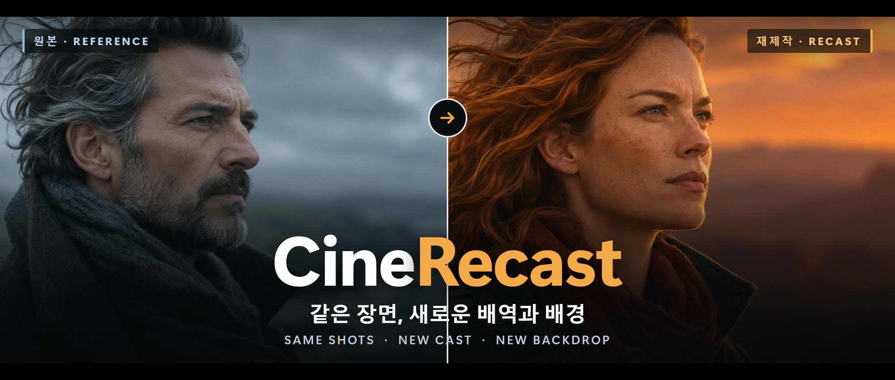
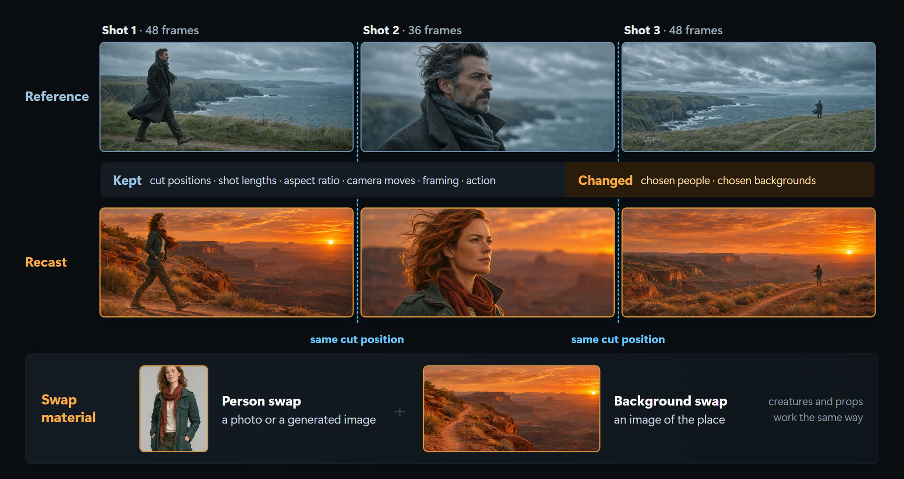
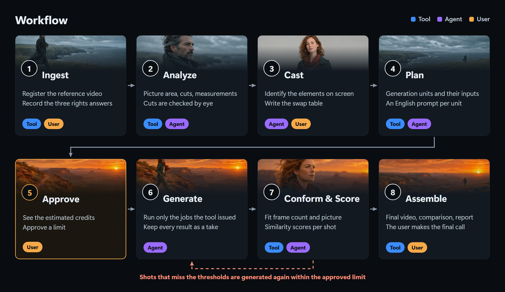
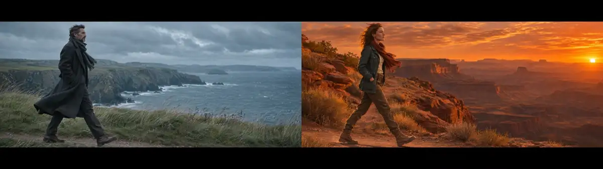
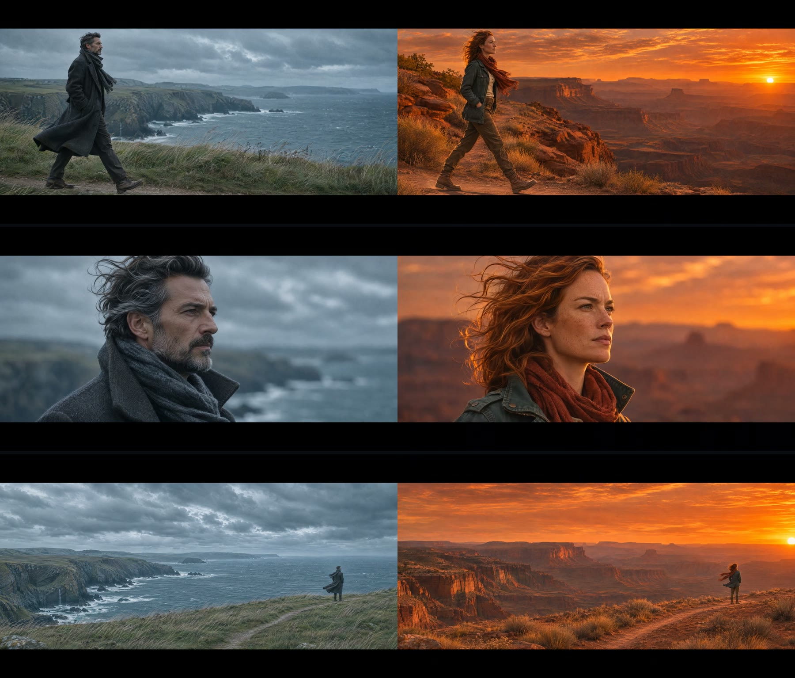
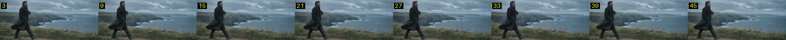
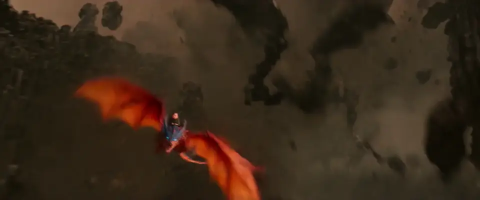
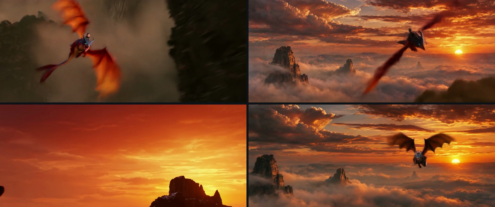
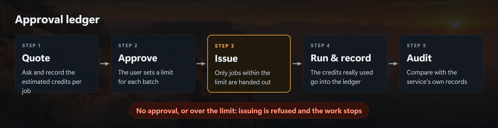

<p align="center">
  
</p>

# CineRecast

[한국어](README.md) | **English**

Recreate a reference video shot for shot, changing **only the people and backgrounds you choose**.

Cut positions, shot lengths, aspect ratio, camera moves, framing and action stay exactly as in the reference. The person you name with a photo and the background you name with an image are the only things that change. The result is a new video made from scratch: it contains no frame and no sound copied from the reference.

> **Status: stage 1 implemented (0.1.0), one run with real generation done**
>
> The core flow from analysis to assembly is implemented and passes its automated tests. A full recreation through paid generation models has been run once; the process and the result are in the [record of the first real run](docs/proof-run.en.md). On real takes the pipeline, frame alignment, scoring and the ledger held up, but generating several shots in one call gave an unusable result. So during that run the tool gained per-shot generation with the user's confirmation of every shot, a project budget, generated music and sound effects with a mix, and extra shots that are not in the reference. What is verified and what is not is written down plainly under [Status and roadmap](#status-and-roadmap).

## Contents

- [What it does](#what-it-does)
- [Who does what](#who-does-what)
- [Example screens](#example-screens)
- [First real run](#first-real-run)
- [Seven design decisions](#seven-design-decisions)
- [Install](#install)
- [Usage](#usage)
- [Commands at a glance](#commands-at-a-glance)
- [Project folder](#project-folder)
- [Status and roadmap](#status-and-roadmap)
- [Rights and responsibility](#rights-and-responsibility)
- [Development](#development)
- [License](#license)

## What it does

<p align="center">
  
</p>

| Stays the same | Changes |
| --- | --- |
| Cut positions and the frame count of every shot | The people you choose (named with photos) |
| Aspect ratio and letterbox bars | The backgrounds you choose (named with images) |
| Camera moves and framing | Other elements you choose (creatures, props) |
| Action and timing inside the frame | |

Elements that are not in the swap table are reproduced as they are. Shots with nothing to swap are regenerated too rather than copied, because a result meant for public or commercial release must not contain any picture taken from the reference.

**Good for**

- Keeping the direction of a scene you like while remaking it with another cast in another place
- Producing several versions of the same advert or music video with different cast and backdrops
- Keeping the cost and the outputs of generated-video work on record

**Not this**

- Not a prompt-to-video generator. A reference video is always required.
- Not a face-swap tool. Whole shots are generated anew.
- Not a generation model. An agent runs video, image and audio generation on Higgsfield models; this tool handles what comes before and after: analysis, planning, cost control, conforming, checking, the sound mix and assembly.

## Who does what

CineRecast has two parts.

- **The command-line tool `cine-recast`** does only the work that has a computable answer: video analysis, swap-table checks, planning, the approval ledger, frame-count conforming, similarity scores, review files, the sound mix, assembly and the report. It makes no network calls, never handles API keys and keeps all state as files in the project folder.
- **The agent skill** is a set of working instructions for a coding agent such as Claude Code or Codex. The agent does what needs eyes and judgement (checking cuts, identifying elements, writing prompts, reviewing results, listing the sounds) and runs the paid generation jobs.

And **the user** decides: the rights answers, what is swapped for what, how much may be spent, which take of each shot is accepted, and whether the result is accepted.

<p align="center">
  
</p>

| Step | What happens | Who |
| --- | --- | --- |
| 1. Ingest | Register the reference video and record the three rights answers | Tool, user |
| 2. Analyze | Find the picture area and the cuts, measure camera, motion and colour per shot; cuts are checked by eye on review images | Tool, agent |
| 3. Cast | Identify the elements on screen and write the swap table; generate swap images when none are supplied | Agent, user |
| 4. Plan | Group shots into generation units and prepare inputs and an English prompt for each | Tool, agent |
| 5. Approve | The user sees the estimated credits per job and approves a limit | User |
| 6. Generate | Run only the jobs the tool has issued; keep each result as a take | Agent |
| 7. Conform and score | Fit frame count and picture to the reference; compute similarity scores per shot | Tool, agent |
| 8. Assemble | Once the user has confirmed a take for every shot, build the final video, a side-by-side comparison and a report; the user makes the final call | Tool, user |

Shots that miss the thresholds are generated again within the approved limit. After assembly, music, sound effects and ambience made new for this film go through the same approval, the tool places them and mixes a soundtrack, and the film is assembled again with it.

## Example screens

> The scene images in this section were generated with a Higgsfield image model, and every person in them is fictional. The examples below come from a real run of the tool on a **three-shot clip** built from those stills with simple camera moves (132 frames, 1280x720, 24 fps, a 2.39:1 picture with black bars). The "recast" side is not the output of a video generation model: it is a stand-in clip built from stills with the person and the background swapped, with the same camera moves. These images show what analysis, conforming and comparison look like; they are not an example of video generation quality.

**Side by side.** Reference on the left, recast on the right. The cuts fall on the same frames, and in all three shots the person's position and size and the camera move are the same; only the look of the person and of the background differs. The tool writes this comparison as a video (`compare.mp4`). The black bars sit in the same place with the same thickness as in the reference.

<p align="center">
  
</p>

<p align="center">
  
</p>

**Cut review image.** For every cut the tool writes one strip of the four frames around it, each labelled with its frame number, so you can see that a new shot starts at frame 48.

<p align="center">
  
</p>

**Shot review image.** Eight evenly spaced frames of one shot, to see at a glance what happens in it.

<p align="center">
  
</p>

**Report.** At the end the tool writes a report (`report.md`, in Korean). This is the per-shot table from the example above, with the column names translated.

| Shot | Frames | Unit | Method | Take | Camera | Motion | Colour | Flicker ratio | Overlap with reference | Verdict |
| --- | --- | --- | --- | --- | --- | --- | --- | --- | --- | --- |
| 1 | 0-48 | u01 | edit | t001 | 1.000 | 0.991 | 0.000 (left out) | 1.968 | 0.000 | pass |
| 2 | 48-84 | u01 | edit | t001 | 1.000 | 0.982 | 0.000 (left out) | 0.361 | 0.001 | pass |
| 3 | 84-132 | u01 | edit | t001 | 1.000 | 0.997 | 0.000 (left out) | 0.619 | 0.000 | pass |

| Batch | Limit | Used | Remaining |
| --- | --- | --- | --- |
| draft-1 | 50.00 | 38.00 | 12.00 |
| Total | 50.00 | 38.00 | 12.00 |

A camera score of 1.000 means the stand-in clip has the same camera move as the reference. "Left out" on the colour score marks a shot whose background was swapped: its colour is expected to differ, so that score is not part of the verdict. The report also carries the rights answers, the swap table, the job numbers of finished jobs and the items still open. The amounts in the table are example numbers, not credits that were spent.

## First real run

On 2026-11-18 a full recreation went through paid generation models for the first time. The reference was a ten-second live-action film clip of five shots, and the rider, the dragon and the sky were swapped. The owner asked for a free cut, so two shots that are not in the reference, sound and end cards were added, for a film of 24.2 seconds. The first pass was not usable; what it showed led to per-shot generation and other features being added to the tool during the run, and the second pass used them.

<p align="center">
  
</p>

<p align="center">
  
</p>

Unlike the example above, the images in this section are made only from frames of real video generation; no frame of the reference is in them. The rider is a young child given by one photograph, with the guardian's consent recorded before any work. Only views in which the rider is small were chosen.

**Five lessons that mattered most**

- One shot per generation. Given several shots at once, the model reorders them or drops one, and the cuts land 3 to 4 frames off.
- A multi-view sheet, not one photograph. With one photograph, people and creatures change from shot to shot.
- Validate on a cheap tier. Five delivery-tier takes made with an unvalidated reference cost 153 credits and were all rejected; the same check at the cheaper tiers would have cost 39.
- Scores do not see people. The similarity scores do not measure whether the right person appears, so every take needs checking by eye.
- A shot with nothing to swap comes back from an edit model almost identical to the reference. Before release, the owner has to decide whether to make it again.

The process, the settings, the cost and all fifteen lessons are in the [record of the first real run](docs/proof-run.en.md).

## Seven design decisions

### 1. Frame-exact

A generation model does not hand back a clip of exactly 37 frames. Length can be chosen only in whole seconds, and frame rate and size differ from the reference. CineRecast takes what comes back and conforms it:

1. Convert the frame rate to exactly the reference rate (fractional rates such as 23.976 fps included).
2. Scale to cover the reference picture area and crop what overflows.
3. Add black bars of the same thickness in the same place as the reference.
4. Cut every shot to the reference frame count.

If the assembled result differs from the reference by even one frame, assembly is refused. Cut positions are therefore off by zero frames.

The shot boundaries inside a take can come back a few frames away from the reference. `takes cuts` finds the cuts in a take and a frozen tail that runs to its end; give the start of every shot with `conform --take-cuts` and the tool fits each stretch to the frame count of its reference shot. Frames added to reach a model's minimum length never reach the final video.

### 2. Checked by eye and by numbers

"Looks close" does not scale to many shots and many takes. The tool compares each conformed take with the reference and scores every shot.

| Score | Meaning | Default threshold |
| --- | --- | --- |
| Frame count | Whether reference and take have the same number of frames | Must match |
| `camera` | How closely the camera move (pan and zoom) matches, 0 to 1 | At least 0.6 |
| `motion` | How closely the distribution of motion in the frame matches, 0 to 1 | At least 0.5 |
| `color` | How close the mean frame colour is, 0 to 1 | At least 0.6 |
| `flicker_ratio` | Flicker of the take divided by flicker of the reference | At most 2.0 |
| `overlap_ratio` | Share of the picture that is nearly identical to the reference | Not part of the verdict |

Thresholds can be changed per project. A shot whose background is swapped is expected to differ in colour, so the tool leaves that shot's colour score out of the verdict automatically and marks it in the report. Scores are a filter, not a judge, and they do not measure whether the right person appears. Takes that pass are still checked on stills by the agent, and before assembly the user watches every shot next to the reference (`takes review`) and confirms only the shots they accept (`takes confirm`). `assemble` refuses while any shot is unconfirmed.

### 3. Not one piece of the reference in the result

A video meant for public or commercial release must not contain picture or sound copied from the reference. This rule is not only written in the skill; the tool enforces it.

- Registering the reference video (the original file outside the project included), its analysis clips or earlier outputs as if they were a generated take, extra shot or sound is refused. Extra shots that are not in the reference are generated like every other shot and pass the same check when registered.
- Giving the reference video, a copy of it, or a project file that can still hold its sound (the comparison video, a received take) as the audio for the final video is refused.
- `sound mix` and `assemble` compare the sound going into the mix and the final video with the reference sound, over the whole film and in every two-second window, and refuse when the reference sound is in it.
- When the picture of a chosen take is almost identical to the reference (overlap of 0.98 or more), the report lists it as an open item for the user to check.

For the picture, what the tool can recognise is the same file and material inside the project; it cannot tell a trimmed or re-encoded copy of the reference video apart. The sound check, too, misses a copy moved more than half a second from its place, buried deep under other sound, or changed in pitch, speed or timbre. So the rule that only files returned by a generation job are registered still has to be kept by the agent and the user.

### 4. Not one credit without approval

<p align="center">
  
</p>

Generation costs money. Every project has an append-only ledger (`ledger.jsonl`), and every paid job, whether video, swap image, sound or extra shot, is controlled through it.

```json
{"type": "approval", "time": "2026-11-18T06:48:25Z", "batch": "draft-1", "limit_credits": 50.0, "by": "owner", "note": ""}
{"type": "job_issued", "time": "2026-11-18T06:48:25Z", "job_id": "j0001", "batch": "draft-1", "est_credits": 40.0}
{"type": "job_done", "time": "2026-11-18T06:48:26Z", "job_id": "j0001", "provider_id": "demo-0001", "credits": 38.0}
```

- The agent first asks the price of every job, records it and shows the user a table.
- Jobs are issued only after an approved limit for their batch is in the ledger. Either the user approves each batch, or the user approves a budget for the whole project once (`budget set`) and the agent records each batch within it. With a budget in place, `approve` refuses an approval that would bring the sum of all batch limits above it.
- Issuing is refused when there is no approval, when the quotes would exceed the limit, or when settings or input files changed after the quote.
- If the ledger is damaged and cannot be read, nothing is issued. When in doubt, the tool stops.
- Job numbers are never reused and takes are never overwritten.
- The ledger file is locked while it is written, so two commands running at the same moment cannot pass one limit together.
- `audit` checks the ledger and shows totals per batch and overall, the budget and what is left of it, and the generation service's job numbers, so that spending can be compared with the service's own records.

Approval is per batch, and a project budget can sit above it. Without a budget, the sum of the approved limits is the project's budget, and the report and `audit` show the total.

### 5. Rights answers on record

When a project starts, the user is asked three questions and the answers are recorded as given.

| Item | The question |
| --- | --- |
| `reference_rights` | Do you have the right to recreate and use this reference video? |
| `likeness_consent` | Is there consent to use the likeness of the person swapped in? |
| `background_rights` | Do you have the right to use the background image swapped in? |

A person swap requires likeness consent recorded as "yes". For your own photo you confirm it yourself; for someone else's photo it means that person has consented. There is one exception: when every person swapped in is a fictional person generated in this project from a text description alone, with no reference photo, "not applicable" is accepted. The check runs not only at planning time but again every time a job is issued, together with a check that the input files about to be sent are still the ones the swap table gives. If the swap table or a rights answer changed after approval so that this check no longer passes, the job is not issued.

### 6. No swap material? Generate it

You do not need a photo of the person or an image of the background. Describe them in words, and image generation jobs produce candidates; the one you pick is registered as the swap image. These jobs go through the same quote, approval and ledger as video jobs. An image given to a generation job as a reference must be one generated in this project or one the swap table names now; any other picture is refused. A photo of a real person, or an image made from one, requires that person's likeness consent to be on record first, and the same rule holds for swap material and for shots that are not in the reference. Prompts for a fictional person never name a real person or ask for a resemblance to one. A person or creature seen from several sides gets a reference sheet with several angles on one image instead of a single photo, and two elements that touch (a person and the animal they ride, say) get a pair sheet showing both at their true relative size; both are made with the same `assets` commands and used as swap images.

### 7. All state is files

Everything about a project lives in JSON and video files in its folder. Work can be resumed days later, handed to another agent, or inspected by a person. The files present tell you how far the project has come. When a hand-edited file is broken, the tool names the file and the line and stops. See [Project folder](#project-folder).

## Install

**Requirements**

- Windows 11 and PowerShell 7 (the environment it was developed and tested in; the installer needs PowerShell 7)
- Python 3.12 or newer
- ffmpeg and ffprobe on PATH (tested with 8.1); the installer warns when they are missing
- For the generation steps: a coding agent with Higgsfield tools connected (for example Claude Code) and Higgsfield credits. Analysis, conforming, scoring, assembly and mixing sounds already received work without them.

**Install**

```powershell
git clone https://github.com/ChoonwooLim/cine-recast.git
cd cine-recast
pwsh -NoProfile -File install.ps1
```

The installer does three things.

1. Creates a dedicated Python environment in `~/.cine-recast/venv` and installs this folder into it.
2. Writes the launcher `~/.cine-recast/bin/cine-recast.ps1`.
3. Copies the skill to `~/.claude/skills/cine-recast` and `~/.codex/skills/cine-recast`. An agent that is not installed (no `~/.claude` or `~/.codex` folder) is skipped. If another folder is already there, it stops instead of overwriting it.

**Check**

```powershell
& "$HOME/.cine-recast/bin/cine-recast.ps1" --version
```

It should print `cine-recast 0.1.0`.

**Uninstall**

```powershell
pwsh -NoProfile -File install.ps1 -Uninstall
```

## Usage

### Hand it to an agent

After installing, say something like this in Claude Code or Codex and the skill takes over. The skill document is written in Korean and the agent talks to the user in Korean.

```text
Recreate this video shot for shot, changing only the person and the background.
Reference: D:\footage\reference.mp4
Person: D:\swap\person_front.jpg
Background: D:\swap\sunset_sky.png
```

The agent follows the skill and stops wherever a decision belongs to the user.

1. Asks the three rights questions and records the answers.
2. Analyzes the video and checks the cuts on the review images.
3. Lists the elements in every shot, writes the swap table and has the user confirm it.
4. Plans one generation unit per shot and writes the prompts, then shows the estimated cost per stage as a table and asks once for a budget for the whole project.
5. Runs the generation jobs **once the user has approved**.
6. Conforms the results, checks them with scores and stills, and for shots that miss the thresholds works out the cause and tries again.
7. Shows every shot next to the reference and confirms only the shots the user accepts.
8. Delivers the final video, the comparison video and the report.
9. Generates music, sound effects and ambience, mixes them and assembles again. The agent cannot hear, so the user listens and says what to change.

The skill is in [skill/SKILL.md](skill/SKILL.md): eleven rules the agent must keep, each with its reason, and the cases in which it must stop and ask.

### Try the command line yourself

Everything up to analysis works without any paid service. Keep project folders outside git repositories.

```powershell
$cr = "$HOME/.cine-recast/bin/cine-recast.ps1"
$p = "$env:USERPROFILE\Videos\cine-recast\my-project"

# 1. Create the project and record the rights answers
& $cr init $p --reference "D:\footage\reference.mp4" --name my-project
& $cr rights set $p --item reference_rights --answer yes
& $cr rights set $p --item likeness_consent --answer yes
& $cr rights set $p --item background_rights --answer yes

# 2. Analyze and write the cut review images
& $cr analyze $p
& $cr cuts review $p

# 3. Write the template for the swap table (casting.json is written from it)
& $cr cast template $p
```

`analyze` prints a line like this:

```text
shots: 3  cuts: [48, 84]  picture: {'x': 0, 'y': 92, 'w': 1280, 'h': 536}
```

`cuts` are the frame numbers at which a new shot starts, and `picture` is the real picture area without the black bars. If the detected cuts or the picture area are wrong, give them yourself and analyze again. The picture area can be misdetected when subtitles sit in a black bar or when the picture is very dark.

```powershell
& $cr analyze $p --cuts "48,84"
& $cr analyze $p --picture "0,140,1920,800"
```

The reference must be an ordinary video file (mp4, mov, mkv and the like) with a constant frame rate, no rotation flag and square pixels. `init` refuses other files and says why; re-encode them with ffmpeg first.

The rest of the flow looks like this. Asking prices and running generation is the agent's part.

```powershell
# 4. Plan (one generation unit per shot)
& $cr cast check $p
& $cr models check $p
& $cr plan build $p --model <model id> --method edit --batch draft-1 --per-shot
& $cr plan check $p

# 5. Project budget (optional), quotes and the approval
& $cr budget set $p --limit 700 --by owner
& $cr jobs list $p
& $cr jobs set-cost $p --job j0001 --credits 40
& $cr approve $p --batch draft-1 --limit 50 --by owner

# 6. Issue, then register the result
& $cr jobs next $p --batch draft-1
& $cr jobs done $p --job j0001 --provider-id <the service's job number> --credits 38 --file "$p\downloads\j0001.mp4"

# 7. Find the shot boundaries in the take, conform and check
& $cr takes cuts $p --unit u01 --take t001
& $cr conform $p --unit u01 --take t001 --take-cuts "0,33"
& $cr qc $p --unit u01 --take t001
& $cr takes select $p --unit u01 --take t001

# 8. The user's confirmation, then assembly
& $cr takes review $p --unit u01 --take t001
& $cr takes confirm $p --unit u01 --take t001 --by owner
& $cr assemble $p
& $cr compare $p
& $cr report $p
& $cr audit $p
```

`plan build --per-shot` makes one unit per shot and pads a shot shorter than the model's minimum length by holding its last frame. `takes cuts` reports the cuts in a take and the frame where a frozen tail begins; `--take-cuts` takes the frame where each shot starts in the take, then the frame after the last shot. To move a single unit to another model, use `plan unit`. `takes confirm` is run only when the user has accepted that shot, and `assemble` builds the final video only when every unit is confirmed; to watch the shots joined before that, use `assemble --preview`.

Sound comes after assembly and follows the same steps. Each sound is given the film frame where it starts; `sound mix` puts every sound in its place and writes a soundtrack, and the next `assemble` includes it.

```powershell
# 9. Sound
& $cr sound add $p --kind sfx --label "door slam" --prompt "Heavy wooden door slams shut in a stone hallway, short echo." --model <audio model id> --seconds 3 --batch sound-1 --shot 3
& $cr sound set-cost $p --sound s0001 --credits 4
& $cr approve $p --batch sound-1 --limit 4 --by owner
& $cr sound next $p --batch sound-1
& $cr sound done $p --sound s0001 --provider-id <the service's job number> --credits 4 --file "$p\downloads\s0001.wav"
& $cr sound mix $p
& $cr assemble $p
```

`sound set` moves a sound, changes its gain or fades, or mutes it, and costs nothing. Shots that are not in the reference (an opening shot, a shot bridging two others) are planned with `extra add` and go through the same quote, approval, issue and registration. To join a confirmed shot, give the last or first frame that conform kept as the start or end picture, as in `--start u01/t001:shot-last` or `--end u02/t001:shot-first`. A frame of the reference video is never a start or end picture, and the tool compares the picture with the reference's frames and refuses a copy. They are cuts for the user to use separately and are never part of `assemble`.

What every command reads, writes and refuses is in [skill/references/workflow.md](skill/references/workflow.md); how generation jobs are run is in [skill/references/generation-jobs.md](skill/references/generation-jobs.md). Both are in Korean.

## Commands at a glance

| Command | What it does |
| --- | --- |
| `init` | Create the project folder and copy the reference video into it |
| `rights set` | Record the answer to one rights item |
| `analyze` | Find the picture area and the cuts, measure every shot; record the timing of the reference sound if it has any |
| `cuts review` | Write images for checking cuts and shots by eye |
| `cast template`, `cast check` | Write the swap-table template; check the swap table and the rights answers |
| `models check` | Check the model information the agent wrote down |
| `assets add`, `list`, `set-cost`, `next`, `done`, `fail`, `use` | Plan, quote, issue and register image generation jobs for swap material, reference sheets included |
| `plan build`, `plan check`, `plan show` | Group shots into generation units, build and check the plan; with `--per-shot`, one unit per shot |
| `plan unit` | Bring one unit's inputs up to date with the swap table, and move it to another model or method |
| `jobs list`, `add`, `set-cost`, `next`, `done`, `fail` | Quote, issue and register video generation jobs |
| `extra add`, `list`, `set-cost`, `next`, `done`, `fail` | Generation jobs for shots that are not in the reference; never part of assembly |
| `sound add`, `list`, `set-cost`, `next`, `done`, `fail` | Plan generation jobs for music, sound effects and ambience, each placed on a film frame |
| `sound set` | Move a sound, change its gain or fades, or mute it; free |
| `sound mix` | Put the finished sounds in place and write the soundtrack (-16 LUFS) |
| `budget set` | Record the project budget in the ledger |
| `approve` | Record the approved limit of a batch in the ledger |
| `audit` | Check the ledger |
| `takes cuts` | Find the cuts inside a take and a frozen tail at its end |
| `conform` | Fit a take's frame rate, picture and frame count to the reference; shot by shot when the boundaries are given |
| `qc` | Compare a conformed take with the reference and score every shot |
| `takes select` | Choose the take that goes into the final video |
| `takes review` | Write a review video and image with the reference and the take side by side |
| `takes confirm` | Record that the user confirmed a shot; required for assembly |
| `assemble` | Join the confirmed takes in reference order into the final video, with the soundtrack when there is one |
| `compare` | Write the side-by-side comparison video |
| `report` | Write the report (Korean) |

## Project folder

A project folder holds the reference video, photos of people and generated material, so it lives outside any git repository. The default place is `%USERPROFILE%\Videos\cine-recast\<project>\`.

```text
<project>/
  project.json                  project info, rights answers, score thresholds
  reference/source.mp4          copy of the reference video
  analysis/
    video.json, cuts.json       video facts and the list of cuts
    audio.json                  timing of the reference sound (no sound in it)
    shots/0001/                 per shot: reference clip, measurements (sheet.json), three stills
    review/                     review images of cuts and shots
    units/u01/ref.mp4           reference clip of a generation unit (a short unit is padded with its last frame)
  casting.json                  elements on screen and the swap table
  models.json                   facts about the generation models in use
  assets.json, assets/          generated swap material
  plan.json, plans/             the current plan (with the user's confirmation per unit) and archived earlier plans
  sounds.json, sounds/          generated sounds and where they sit in the film
  extras.json, extras/          jobs and results for shots that are not in the reference
  ledger.jsonl                  the approval ledger, project budget included
  takes/u01/t001/               per take: the file as received, conformed shot clips, scores, review files
  out/
    preview.mp4                 preview before confirmation
    soundtrack.wav              the mixed soundtrack (its record in soundtrack.json)
    master.mov, final.mp4       the result (ProRes master and delivery file)
    compare.mp4                 side-by-side comparison (for review only)
    report.md                   the report
```

## Status and roadmap

**Verified**

- 703 automated tests pass. The tests build their own synthetic clips with ffmpeg, so the repository contains no video files.
- The whole flow, from creating a project to the final video, the comparison video, the report and the ledger audit, has been run from the command line on the example clip (three shots built from generated stills, with a stand-in clip in place of a generated video). That run predates per-shot confirmation and the sound stage.
- On a ten-second letterboxed live-action clip (1920x1080, 23.976 fps, 240 frames, five shots) the picture area and all four cuts were found with zero frames of error.
- A full recreation of the same clip through paid generation models has been run once (rider, dragon and sky swapped). In the first pass, with the tool as it was before per-shot generation, `conform`, `qc`, `assemble`, `compare`, `report` and `audit` ran end to end on real generated takes, produced a 240-frame, 10.01 s file, and judged three of the five shots `retry`. But with several shots grouped into one generation unit, the model reordered the shots, dropped one and put the cuts 3 to 4 frames off, and one photograph per element left the rider and the dragon looking different from shot to shot, so the result was not usable. What it showed led to per-shot generation (padding of short shots and per-shot conforming), `plan unit`, the user's confirmation of every shot, the project budget, the sound stage and extra shots, all built during the run; the second pass used them. The ledger of the whole run was checked with `audit`: 62 jobs, 447.63 of 639.13 approved credits spent, all consistent. The details are in the [record of the first real run](docs/proof-run.en.md).
- The approval ledger is covered by tests for issuing without approval, exceeding the limit, a damaged ledger, changes made after a quote and two commands running at the same moment.
- The first implementation of stage 1 was read through in full by an independent reviewer, and a fresh agent that had only the skill document followed it from start to finish in a dry run. The problems they found have been fixed.

**Not in the tool yet, or not verified**

- A free cut longer or shorter than the reference, and end cards, are not in the tool. The tool's `assemble` and `sound mix` make the version with the same frame count as the reference. The finished film of the first real run is a free cut, so it was cut and mixed outside the tool with hand-written ffmpeg scripts, and the soundtrack from the tool's `sound mix` is not in it.
- There is no step for finishing (enlarging) a confirmed take. The last shot of the first real run is a low-resolution validation take, enlarged.
- The similarity scores do not measure whether the right person appears. Every take has to be checked by eye.
- The agent cannot hear. The sound of the first real run was set from measurements only and still needs a human ear.
- The full flow through real generation has been run only this once.
- Picture quality and consistency of the result depend on the generation model used. What this tool guarantees is the match in structure (cuts, lengths, picture), the measurements, and control over cost and rights.

**Roadmap**

| Stage | Scope | State |
| --- | --- | --- |
| 1 | Ingest, analysis, casting, planning, the generation path, conforming, checking, the user's confirmation, assembly | Implemented; one run with real generation done |
| 2 | Compositing path: build the background separately and composite it in shots with a moving camera | Planned |
| 3 | Recreated music, sound effects and dialogue, lip sync, 4K finishing | Partly done: generating music and sound effects through the ledger and mixing them is in the tool. Recreating dialogue, lip sync and 4K finishing are planned |

**Good to know**

- Built for videos of some tens of seconds. Analysis of a video several minutes long takes a long time.
- Cut detection finds cuts where the scene changes within one frame. Gradual transitions such as dissolves and fades are not detected; give them with `--cuts`.
- When `sound mix` has written a soundtrack, `assemble` puts it in; without one, the video has no sound. An audio file the user made can go in instead with `--audio`, and `--silent` leaves the sound out even when there is a soundtrack. The sound of the reference is never used.
- There is no automatic matching of the result's colour to the grade of the reference yet.
- The default score thresholds were set on synthetic clips and are still unchanged. In the first real run the scores judged three of the five shots `retry`. They do not measure whether the right person appears, so every take was also checked by eye.
- Run the tool's commands one at a time.
- Tested on Windows only.

## Rights and responsibility

- This tool does not judge rights. It asks, records the answers, and stops when an answer is missing. Whether you may recreate and publish the reference video, whether the person swapped in has consented, and whether you may use the background image are for you to confirm and answer for.
- Not using frames of the reference does not make questions about rights in the reference go away. That is why the first item asks about your rights in the reference video.
- Do not use this tool to make videos of people who have not consented.
- The terms and the costs of the generation service are between you and that service.

## Development

```powershell
pwsh -NoProfile -File install.ps1
& "$HOME\.cine-recast\venv\Scripts\python.exe" -m pytest tests -q
```

- Code, comments, error messages and generation prompts are English; the skill documents and the report are Korean.
- No Chinese (Han characters) anywhere in the repository. A test checks it.
- No code copied from other projects.
- This repository is public. Never commit keys, personal paths, photos of people or working video.

The full rules for agents and contributors are in [AGENTS.md](AGENTS.md). The background and the decisions of the design are in the [design document](docs/2026-11-18-cine-recast-design.md) and the stage 1 tasks in the [implementation plan](docs/2026-11-18-stage1-core-plan.md) (both Korean).

## License

Not chosen yet. Until a license is chosen, no right to reuse the code or documents in this repository is granted.
