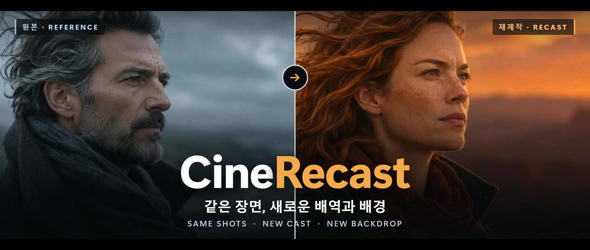
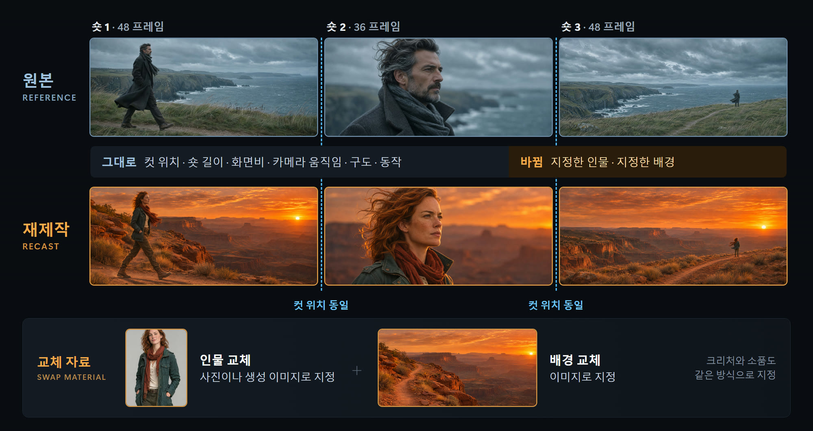
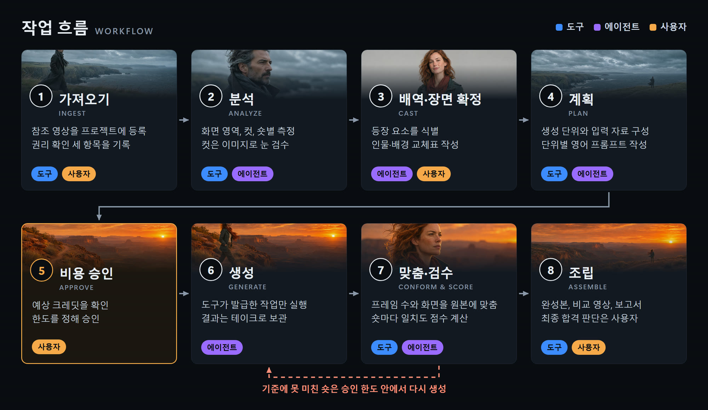
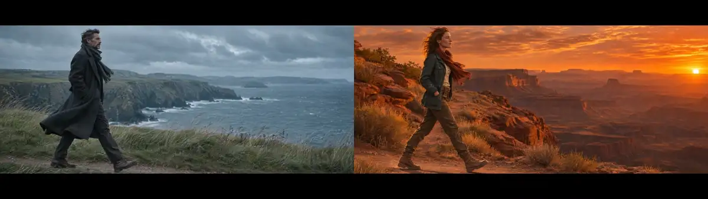
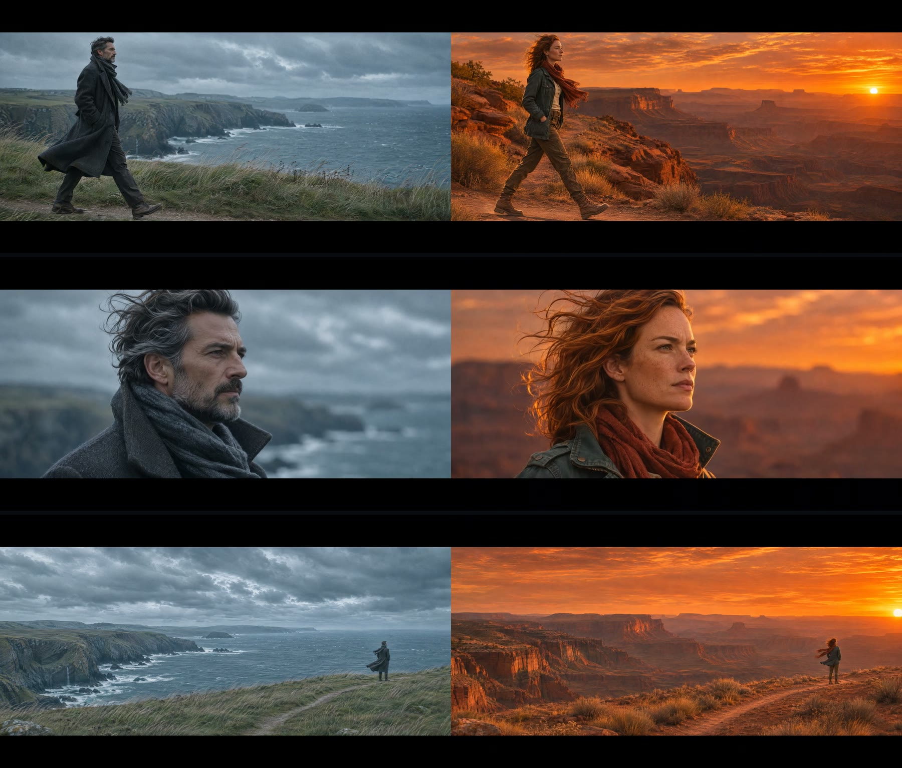
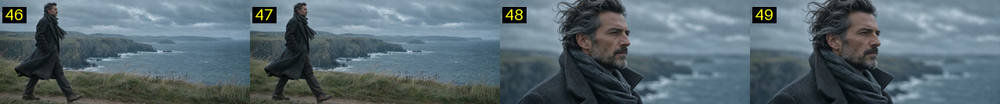
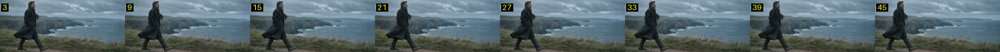
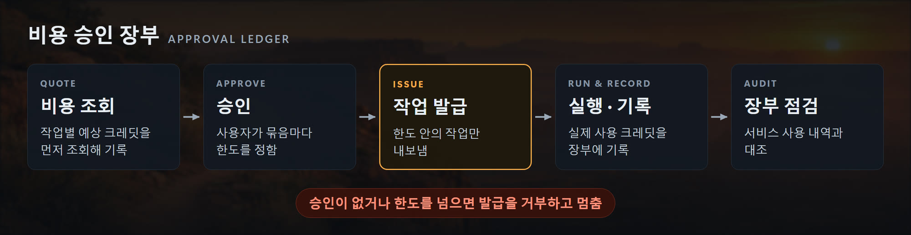

<p align="center">
  
</p>

# CineRecast

**한국어** | [English](README.en.md)

참조 영상을 숏 단위로 똑같이 다시 만들되, **지정한 인물과 배경만 바꾸는** 도구입니다.

컷 위치, 숏 길이, 화면비, 카메라 움직임, 구도, 동작은 원본 그대로 둡니다. 사진으로 지정한 인물과 이미지로 지정한 배경만 새것으로 바뀝니다. 완성본은 원본의 프레임이나 소리를 한 조각도 담지 않은, 처음부터 새로 만든 영상입니다.

> **상태: 1단계 구현 완료 (0.1.0)**
>
> 분석부터 조립까지의 핵심 흐름이 구현되어 있고 자동 테스트를 통과합니다. 유료 생성 모델을 거친 전체 재제작 검증은 아직 하지 않았습니다. 무엇이 검증되었고 무엇이 남았는지는 [현재 상태와 계획](#현재-상태와-계획)에 그대로 적었습니다.

## 목차

- [무엇을 하나요](#무엇을-하나요)
- [일은 이렇게 나뉩니다](#일은-이렇게-나뉩니다)
- [예시 화면](#예시-화면)
- [설계의 핵심 일곱 가지](#설계의-핵심-일곱-가지)
- [설치](#설치)
- [사용법](#사용법)
- [명령 한눈에 보기](#명령-한눈에-보기)
- [프로젝트 폴더](#프로젝트-폴더)
- [현재 상태와 계획](#현재-상태와-계획)
- [권리와 책임](#권리와-책임)
- [개발](#개발)
- [라이선스](#라이선스)

## 무엇을 하나요

<p align="center">
  
</p>

| 그대로 두는 것 | 바꾸는 것 |
| --- | --- |
| 컷 위치와 숏의 프레임 수 | 지정한 인물 (사진으로 지정) |
| 화면비와 검은 띠(레터박스) | 지정한 배경 (이미지로 지정) |
| 카메라 움직임과 구도 | 그 밖에 지정한 요소 (크리처, 소품) |
| 화면 속 동작과 타이밍 | |

교체표에 적지 않은 요소는 원본과 같게 재현합니다. 교체할 것이 없는 숏도 원본을 복사하지 않고 다시 생성합니다. 완성본을 공개하거나 상업적으로 쓸 수 있으려면 원본에서 가져온 화면이 조금도 들어가면 안 되기 때문입니다.

**이런 일에 맞습니다.**

- 마음에 드는 장면의 연출을 그대로 살려, 다른 배우와 다른 장소로 다시 만들고 싶을 때
- 같은 광고나 뮤직비디오를 배역과 배경만 바꿔 여러 벌 만들어야 할 때
- 생성 영상 작업에서 비용과 결과물을 기록으로 관리하고 싶을 때

**이런 도구는 아닙니다.**

- 프롬프트 한 줄로 새 영상을 만드는 생성기가 아닙니다. 기준이 되는 참조 영상이 반드시 있어야 합니다.
- 얼굴만 덧씌우는 합성 도구가 아닙니다. 숏 전체를 새로 생성합니다.
- 생성 모델 자체가 아닙니다. 영상과 이미지 생성은 에이전트가 Higgsfield의 모델로 실행하고, 이 도구는 그 앞뒤의 분석, 계획, 비용 관리, 맞춤, 검수, 조립을 맡습니다.

## 일은 이렇게 나뉩니다

CineRecast는 두 부분으로 되어 있습니다.

- **명령줄 도구 `cine-recast`** : 계산으로 답이 정해지는 일만 합니다. 영상 분석, 교체표 검사, 계획, 비용 승인 장부, 프레임 수 맞춤, 일치도 점수, 조립, 보고서. 네트워크를 쓰지 않고, API 키를 다루지 않으며, 모든 상태를 프로젝트 폴더의 파일로 남깁니다.
- **에이전트 스킬** : Claude Code나 Codex 같은 코딩 에이전트가 읽고 따르는 작업 지침입니다. 눈으로 판단해야 하는 일(컷 검수, 등장 요소 식별, 프롬프트 작성, 결과 검수)과 유료 생성 작업의 실행을 맡습니다.

그리고 **사용자**가 결정합니다. 권리 확인, 무엇을 무엇으로 바꿀지, 얼마까지 쓸지, 최종 합격 여부는 사용자의 몫입니다.

<p align="center">
  
</p>

| 단계 | 하는 일 | 담당 |
| --- | --- | --- |
| 1. 가져오기 | 참조 영상을 프로젝트에 등록하고 권리 확인 세 항목을 기록 | 도구, 사용자 |
| 2. 분석 | 화면 영역과 컷을 찾고 숏마다 카메라, 움직임, 색을 측정. 컷은 이미지로 눈 검수 | 도구, 에이전트 |
| 3. 배역·장면 확정 | 등장 요소를 식별하고 인물·배경 교체표를 작성. 교체 자료가 없으면 생성 | 에이전트, 사용자 |
| 4. 계획 | 숏을 생성 단위로 묶고 단위마다 입력 자료와 영어 프롬프트를 준비 | 도구, 에이전트 |
| 5. 비용 승인 | 작업별 예상 크레딧을 보고 사용자가 한도를 승인 | 사용자 |
| 6. 생성 | 도구가 발급한 작업만 실행하고 결과를 테이크로 보관 | 에이전트 |
| 7. 맞춤·검수 | 프레임 수와 화면을 원본에 맞추고 숏마다 일치도 점수를 계산 | 도구, 에이전트 |
| 8. 조립 | 완성본, 좌우 비교 영상, 보고서를 만들고 사용자가 최종 판단 | 도구, 사용자 |

기준에 못 미친 숏은 승인 한도 안에서 다시 생성합니다.

## 예시 화면

> 이 페이지의 장면 이미지는 Higgsfield의 이미지 모델로 생성한 것이고, 나오는 인물은 모두 가상 인물입니다. 아래 예시는 그 스틸에 단순한 카메라 움직임을 입혀 만든 **3숏짜리 영상**(132프레임, 1280x720, 24 fps, 2.39:1 화면에 검은 띠)으로 도구를 실제로 돌려 얻은 것입니다. 오른쪽의 "재제작" 쪽은 영상 생성 모델의 결과가 아니라, 인물과 배경을 바꾼 스틸에 같은 카메라 움직임을 입힌 대역 영상입니다. 분석, 맞춤, 비교가 어떻게 보이는지를 보여 주는 예시이며 영상 생성 품질의 예시가 아닙니다.

**좌우 비교.** 왼쪽이 원본, 오른쪽이 재제작본입니다. 컷이 같은 프레임에서 바뀌고, 세 숏 모두 인물의 위치와 크기, 카메라 움직임이 같으며, 인물과 배경의 모습만 다릅니다. 도구는 이 비교를 영상(`compare.mp4`)으로 만들어 줍니다. 검은 띠도 원본과 같은 자리에 같은 두께로 들어갑니다.

<p align="center">
  
</p>

<p align="center">
  
</p>

**컷 검수 이미지.** 도구는 컷마다 앞뒤 네 프레임을 한 줄로 붙인 이미지를 만듭니다. 칸마다 프레임 번호가 적혀 있어서, 48번 프레임에서 새 숏이 시작한다는 것을 눈으로 확인할 수 있습니다.

<p align="center">
  
</p>

**숏 검수 이미지.** 숏마다 고르게 뽑은 여덟 프레임입니다. 숏 안에서 무슨 일이 일어나는지 한눈에 봅니다.

<p align="center">
  
</p>

**보고서.** 작업이 끝나면 한국어 보고서(`report.md`)가 나옵니다. 아래는 위 예시에서 나온 숏별 결과 표입니다.

| 숏 | 프레임 범위 | 단위 | 방법 | 선택 테이크 | 카메라 | 움직임 | 색 | 깜빡임 비율 | 원본 유사 영역 | 판정 |
| --- | --- | --- | --- | --- | --- | --- | --- | --- | --- | --- |
| 1 | 0-48 | u01 | edit | t001 | 1.000 | 0.991 | 0.000 (제외) | 1.968 | 0.000 | pass |
| 2 | 48-84 | u01 | edit | t001 | 1.000 | 0.982 | 0.000 (제외) | 0.361 | 0.001 | pass |
| 3 | 84-132 | u01 | edit | t001 | 1.000 | 0.997 | 0.000 (제외) | 0.619 | 0.000 | pass |

| 묶음 | 한도 | 사용 | 잔액 |
| --- | --- | --- | --- |
| draft-1 | 50.00 | 38.00 | 12.00 |
| 합계 | 50.00 | 38.00 | 12.00 |

카메라 점수 1.000은 대역 영상의 카메라 움직임이 원본과 같다는 뜻입니다. 색 점수의 `(제외)`는 배경을 바꾼 숏이라 색이 달라지는 것이 당연해서 판정에서 뺐다는 표시입니다. 보고서에는 이 밖에 권리 확인, 교체표, 끝난 작업의 번호, 아직 해결되지 않은 항목이 실립니다. 표의 금액은 예시로 넣은 숫자이며 실제로 쓴 크레딧이 아닙니다.

## 설계의 핵심 일곱 가지

### 1. 프레임 단위로 맞춥니다

생성 모델은 정확히 37프레임짜리 영상을 주지 않습니다. 길이는 초 단위로만 고를 수 있고, 프레임 속도와 화면 크기도 원본과 다릅니다. CineRecast는 결과물을 받아서 원본에 맞춥니다.

1. 프레임 속도를 원본과 같은 값으로 바꿉니다(23.976 fps 같은 분수 값도 정확히).
2. 원본의 화면 영역을 가득 채우도록 크기를 맞추고 넘치는 부분을 잘라 냅니다.
3. 원본과 같은 위치에 같은 두께의 검은 띠를 붙입니다.
4. 숏마다 원본과 같은 프레임 수로 자릅니다.

이어 붙인 완성본의 프레임 수가 원본과 한 프레임이라도 다르면 조립을 거부합니다. 그래서 컷 위치의 오차는 0프레임입니다.

### 2. 눈과 숫자로 함께 검수합니다

"비슷해 보인다"는 느낌만으로는 여러 숏과 여러 테이크를 관리할 수 없습니다. 도구는 맞춘 테이크를 원본과 비교해 숏마다 점수를 냅니다.

| 점수 | 뜻 | 기본 기준 |
| --- | --- | --- |
| 프레임 수 | 원본과 테이크의 프레임 수가 같은지 | 같아야 함 |
| `camera` | 카메라 움직임(이동과 확대)이 닮은 정도, 0에서 1 | 0.6 이상 |
| `motion` | 화면 속 움직임의 분포가 닮은 정도, 0에서 1 | 0.5 이상 |
| `color` | 프레임의 평균 색이 가까운 정도, 0에서 1 | 0.6 이상 |
| `flicker_ratio` | 테이크의 깜빡임을 원본의 깜빡임으로 나눈 값 | 2.0 이하 |
| `overlap_ratio` | 원본과 거의 같은 화면 영역의 비율 | 판정에 쓰지 않음(참고) |

기준은 프로젝트마다 바꿀 수 있습니다. 배경을 바꾼 숏은 색이 달라지는 것이 당연하므로, 도구가 그 숏의 색 점수를 판정에서 자동으로 빼고 보고서에 `(제외)`로 표시합니다. 점수는 걸러 내는 도구일 뿐이고, 통과한 테이크도 에이전트가 스틸로 확인한 뒤 사용자가 마지막에 직접 봅니다.

### 3. 원본은 한 조각도 섞지 않습니다

공개하거나 상업적으로 쓸 영상에는 원본에서 복사한 화면이나 소리가 들어가면 안 됩니다. 이 규칙은 스킬 문서에만 적혀 있지 않고 도구가 직접 막습니다.

- 원본 영상(프로젝트 밖에 있는 원본 파일도 포함), 분석용 클립, 이전 결과물을 생성 결과인 것처럼 테이크로 등록하면 거부합니다.
- 완성본에 넣을 오디오로 원본 영상이나 그 사본, 원본의 소리가 남아 있을 수 있는 프로젝트 안의 파일(비교 영상, 받은 테이크)을 주면 거부합니다.
- 선택한 테이크의 화면이 원본과 거의 같으면(원본 유사 영역 0.98 이상) 보고서의 열린 항목에 올려 사용자가 확인하게 합니다.

도구가 알아보는 것은 같은 파일과 프로젝트 안의 자료까지입니다. 원본을 잘라 내거나 다시 인코딩한 파일까지 가려내지는 못하므로, 생성 작업이 돌려준 파일만 등록한다는 규칙은 에이전트와 사용자가 함께 지켜야 합니다.

### 4. 승인 없이는 한 크레딧도 쓰지 않습니다

<p align="center">
  
</p>

생성은 돈이 듭니다. CineRecast는 프로젝트마다 덧붙이기만 하는 장부(`ledger.jsonl`)를 두고, 유료 작업을 이 장부로 통제합니다.

```json
{"type": "approval", "time": "2026-11-18T06:48:25Z", "batch": "draft-1", "limit_credits": 50.0, "by": "owner", "note": ""}
{"type": "job_issued", "time": "2026-11-18T06:48:25Z", "job_id": "j0001", "batch": "draft-1", "est_credits": 40.0}
{"type": "job_done", "time": "2026-11-18T06:48:26Z", "job_id": "j0001", "provider_id": "demo-0001", "credits": 38.0}
```

- 에이전트는 작업마다 가격을 먼저 조회해 기록하고, 사용자에게 표로 보여 줍니다.
- 사용자가 묶음(batch)마다 한도를 승인해야 작업이 발급됩니다.
- 승인이 없거나, 견적을 더하면 한도를 넘거나, 견적을 받은 뒤에 설정이나 입력 파일이 바뀌었으면 발급을 거부합니다.
- 장부가 손상되어 읽을 수 없으면 아무것도 발급하지 않습니다. 의심스러우면 멈추는 쪽으로 만들었습니다.
- 한 번 쓴 작업 번호는 다시 쓰지 않고, 테이크는 덮어쓰지 않습니다.
- 장부에 쓰는 동안에는 파일을 잠가서, 두 명령이 동시에 돌아도 한도를 함께 넘기지 못합니다.
- `audit` 명령이 장부를 점검하고, 묶음별 합계와 함께 생성 서비스의 작업 번호를 모아 보여 줍니다. 서비스의 실제 사용 내역과 대조할 수 있습니다.

승인은 묶음 단위입니다. 프로젝트 전체에 대한 별도의 상한은 없고, 승인한 한도의 합계가 곧 그 프로젝트의 예산이며 보고서와 `audit`에 합계가 나옵니다.

### 5. 권리 확인을 기록으로 남깁니다

프로젝트를 시작할 때 세 가지를 사용자에게 묻고 답을 그대로 기록합니다.

| 항목 | 묻는 것 |
| --- | --- |
| `reference_rights` | 이 참조 영상을 재제작해 쓸 권리가 있는가 |
| `likeness_consent` | 교체해 넣을 인물의 초상 사용 동의가 있는가 |
| `background_rights` | 교체해 넣을 배경 이미지를 쓸 권리가 있는가 |

인물을 교체하려면 초상 동의가 "예"로 기록되어 있어야 합니다. 본인 사진이면 본인이 확인하면 되고, 다른 사람의 사진이면 그 사람의 동의를 받았다는 뜻입니다. 예외는 하나뿐입니다. 교체 인물이 모두 이 프로젝트에서 참조 사진 없이 글로만 묘사해 생성한 가상 인물이면 "해당 없음"으로 통과합니다. 이 검사는 계획을 세울 때뿐 아니라 작업을 발급하는 순간마다 다시 하고, 그때 실제로 보낼 입력 파일이 지금의 교체표와 같은지도 함께 봅니다. 승인 뒤에 교체표나 권리 답이 바뀌어 이 검사를 통과하지 못하면 작업이 나가지 않습니다.

### 6. 교체 자료가 없으면 만들어 씁니다

바꿔 넣을 인물 사진이나 배경 이미지가 없어도 됩니다. 글로 묘사하면 이미지 생성 작업으로 후보를 만들고, 그중 고른 한 장을 교체 자료로 등록합니다. 이 작업도 영상 생성과 똑같이 견적, 승인, 장부를 거칩니다. 실제 인물의 사진을 참조로 넣어 만들 때는 그 인물의 초상 동의가 먼저 기록되어 있어야 합니다. 가상 인물의 프롬프트에는 실존 인물의 이름이나 "누구를 닮은" 같은 표현을 쓰지 않습니다.

### 7. 모든 상태가 파일입니다

프로젝트의 상태는 전부 프로젝트 폴더의 JSON 파일과 영상 파일에 있습니다. 작업을 며칠 뒤에 이어 하거나, 다른 에이전트가 넘겨받거나, 사람이 직접 들여다보기 쉽습니다. 어떤 파일이 있는지 보면 어느 단계까지 왔는지 알 수 있습니다. 손으로 고친 파일이 깨졌으면 어느 파일의 몇째 줄이 잘못됐는지 알려 주고 멈춥니다. 구조는 [프로젝트 폴더](#프로젝트-폴더)에 있습니다.

## 설치

**필요한 것**

- Windows 11과 PowerShell 7 (개발과 시험을 이 환경에서 했고, 설치 스크립트는 PowerShell 7이 있어야 돕니다)
- Python 3.12 이상
- ffmpeg와 ffprobe가 PATH에 있을 것 (8.1에서 시험). 없으면 설치 스크립트가 경고합니다
- 생성 단계에는 Higgsfield 도구가 연결된 코딩 에이전트(Claude Code 등)와 Higgsfield 크레딧. 분석, 맞춤, 검수, 조립은 이것 없이도 됩니다.

**설치**

```powershell
git clone https://github.com/ChoonwooLim/cine-recast.git
cd cine-recast
pwsh -NoProfile -File install.ps1
```

설치 스크립트가 하는 일은 세 가지입니다.

1. `~/.cine-recast/venv`에 전용 파이썬 환경을 만들고 이 폴더를 설치합니다.
2. 실행 스크립트 `~/.cine-recast/bin/cine-recast.ps1`을 만듭니다.
3. 스킬을 `~/.claude/skills/cine-recast`와 `~/.codex/skills/cine-recast`에 복사합니다. Claude Code나 Codex가 설치되어 있지 않으면(`~/.claude`, `~/.codex` 폴더가 없으면) 그쪽은 건너뜁니다. 그 자리에 다른 폴더가 이미 있으면 덮어쓰지 않고 멈춥니다.

**확인**

```powershell
& "$HOME/.cine-recast/bin/cine-recast.ps1" --version
```

`cine-recast 0.1.0`이 나오면 됩니다.

**제거**

```powershell
pwsh -NoProfile -File install.ps1 -Uninstall
```

## 사용법

### 에이전트에게 맡기기

설치한 뒤 Claude Code나 Codex에서 이렇게 말하면 스킬이 작업을 시작합니다.

```text
이 영상을 인물과 배경만 바꿔서 숏 단위로 똑같이 다시 만들어줘.
참조 영상: D:\footage\reference.mp4
인물: D:\swap\person_front.jpg
배경: D:\swap\sunset_sky.png
```

에이전트는 스킬 문서를 따라 다음 순서로 진행하며, 사용자의 결정이 필요한 곳에서 멈춰 묻습니다.

1. 권리 확인 세 항목을 묻고 기록합니다.
2. 영상을 분석하고, 컷 검수 이미지를 보고 컷을 확인합니다.
3. 숏마다 등장하는 요소를 정리해 교체표를 만들고 사용자에게 확인받습니다.
4. 생성 계획과 프롬프트를 만들고, 작업별 예상 크레딧을 표로 보여 줍니다.
5. **사용자가 한도를 승인하면** 생성 작업을 실행합니다.
6. 결과를 원본에 맞추고, 점수와 스틸로 검수하고, 기준에 못 미친 숏은 원인을 판단해 다시 시도합니다.
7. 완성본, 비교 영상, 보고서를 만들어 내놓습니다.

스킬 문서는 [skill/SKILL.md](skill/SKILL.md)에 있습니다. 에이전트가 지켜야 할 열 가지 규칙과 그 이유, 멈추고 물어야 하는 경우가 적혀 있습니다.

### 명령줄로 직접 해 보기

분석까지는 유료 서비스 없이 바로 해 볼 수 있습니다. 프로젝트 폴더는 git 저장소 밖에 둡니다.

```powershell
$cr = "$HOME/.cine-recast/bin/cine-recast.ps1"
$p = "$env:USERPROFILE\Videos\cine-recast\my-project"

# 1. 프로젝트를 만들고 권리 확인을 기록합니다
& $cr init $p --reference "D:\footage\reference.mp4" --name my-project
& $cr rights set $p --item reference_rights --answer yes
& $cr rights set $p --item likeness_consent --answer yes
& $cr rights set $p --item background_rights --answer yes

# 2. 분석하고 컷 검수 이미지를 만듭니다
& $cr analyze $p
& $cr cuts review $p

# 3. 교체표의 틀을 만듭니다 (casting.json은 이 틀을 보고 씁니다)
& $cr cast template $p
```

`analyze`는 이런 줄을 냅니다.

```text
shots: 3  cuts: [48, 84]  picture: {'x': 0, 'y': 92, 'w': 1280, 'h': 536}
```

`cuts`는 새 숏이 시작하는 프레임 번호이고, `picture`는 검은 띠를 뺀 실제 화면 영역입니다. 검출된 컷이나 화면 영역이 틀렸으면 직접 지정해 다시 분석합니다. 자막이 검은 띠에 걸쳐 있거나 화면이 아주 어두운 영상에서 화면 영역이 틀리게 잡힐 수 있습니다.

```powershell
& $cr analyze $p --cuts "48,84"
& $cr analyze $p --picture "0,140,1920,800"
```

참조 영상은 프레임 속도가 일정하고, 회전 정보가 없고, 픽셀이 정사각형인 일반적인 영상 파일(mp4, mov, mkv 등)이어야 합니다. 그렇지 않은 파일은 `init`이 이유와 함께 거부하므로 ffmpeg로 다시 인코딩한 뒤 등록합니다.

그 뒤의 흐름은 다음과 같습니다. 가격 조회와 생성 실행은 에이전트가 맡는 부분입니다.

```powershell
# 4. 계획
& $cr cast check $p
& $cr models check $p
& $cr plan build $p --model <모델 id> --method edit --batch draft-1
& $cr plan check $p

# 5. 견적 기록과 승인
& $cr jobs list $p
& $cr jobs set-cost $p --job j0001 --credits 40
& $cr approve $p --batch draft-1 --limit 50 --by owner

# 6. 발급, 그리고 결과 등록
& $cr jobs next $p --batch draft-1
& $cr jobs done $p --job j0001 --provider-id <생성 서비스의 작업 번호> --credits 38 --file "$p\downloads\j0001.mp4"

# 7. 맞춤과 검수
& $cr conform $p --unit u01 --take t001
& $cr qc $p --unit u01 --take t001
& $cr takes select $p --unit u01 --take t001

# 8. 조립
& $cr assemble $p
& $cr compare $p
& $cr report $p
& $cr audit $p
```

명령마다 읽는 파일, 쓰는 파일, 거부되는 경우는 [skill/references/workflow.md](skill/references/workflow.md)에, 생성 작업을 실행하는 절차는 [skill/references/generation-jobs.md](skill/references/generation-jobs.md)에 있습니다.

## 명령 한눈에 보기

| 명령 | 하는 일 |
| --- | --- |
| `init` | 프로젝트 폴더를 만들고 참조 영상을 복사 |
| `rights set` | 권리 확인 한 항목의 답을 기록 |
| `analyze` | 화면 영역과 컷을 찾고 숏마다 측정 |
| `cuts review` | 컷과 숏을 눈으로 검수할 이미지를 생성 |
| `cast template`, `cast check` | 교체표의 틀을 만들고, 교체표와 권리 답을 검사 |
| `models check` | 에이전트가 적은 모델 정보를 검사 |
| `assets add`, `list`, `set-cost`, `next`, `done`, `fail`, `use` | 교체 자료 이미지의 생성 작업을 계획, 견적, 발급, 등록 |
| `plan build`, `plan check`, `plan show` | 숏을 생성 단위로 묶어 계획을 만들고 검사 |
| `jobs list`, `add`, `set-cost`, `next`, `done`, `fail` | 영상 생성 작업의 견적, 발급, 결과 등록 |
| `approve` | 묶음의 승인 한도를 장부에 기록 |
| `audit` | 장부를 점검 |
| `conform` | 테이크의 프레임 속도, 화면, 프레임 수를 원본에 맞춤 |
| `qc` | 맞춘 테이크를 원본과 비교해 숏마다 점수를 계산 |
| `takes select` | 완성본에 쓸 테이크를 선택 |
| `assemble` | 고른 테이크를 원본 순서대로 이어 완성본을 생성 |
| `compare` | 원본과 완성본을 좌우로 놓은 비교 영상을 생성 |
| `report` | 한국어 보고서를 작성 |

## 프로젝트 폴더

프로젝트 폴더에는 원본 영상, 인물 사진, 생성물이 들어가므로 git 저장소 밖에 둡니다. 기본 위치는 `%USERPROFILE%\Videos\cine-recast\<프로젝트>\`입니다.

```text
<프로젝트>/
  project.json                  프로젝트 정보, 권리 확인, 점수 기준
  reference/source.mp4          참조 영상의 사본
  analysis/
    video.json, cuts.json       영상 정보와 컷 목록
    shots/0001/                 숏마다: 참조 클립, 측정값(sheet.json), 스틸 세 장
    review/                     컷과 숏의 검수 이미지
    units/u01/ref.mp4           생성 단위의 참조 클립
  casting.json                  등장 요소와 교체표
  models.json                   쓸 수 있는 생성 모델의 정보
  assets.json, assets/          생성한 교체 자료
  plan.json, plans/             현재 계획과 보관된 이전 계획
  ledger.jsonl                  비용 승인 장부
  takes/u01/t001/               테이크마다: 받은 원본 파일, 맞춘 숏 클립, 점수
  out/
    master.mov, final.mp4       완성본 (ProRes 마스터와 배포용)
    compare.mp4                 좌우 비교 영상 (검토용)
    report.md                   보고서
```

## 현재 상태와 계획

**검증된 것**

- 자동 테스트 381개가 통과합니다. 테스트는 ffmpeg로 합성 클립을 직접 만들어 쓰므로 저장소에 영상 파일이 없습니다.
- 예시 클립(생성한 스틸로 만든 3숏짜리 영상)으로 프로젝트 생성부터 완성본, 비교 영상, 보고서, 장부 점검까지 전 과정을 명령줄로 실행했습니다(영상 생성 결과는 대역 영상으로 대신했습니다).
- 검은 띠가 있는 10초짜리 실사 영상 클립(1920x1080, 23.976 fps, 240프레임, 5숏)에서 화면 영역과 컷 네 곳을 프레임 오차 없이 찾았습니다.
- 비용 승인 장부는 승인 없는 발급, 한도 초과, 손상된 장부, 견적 뒤의 변경, 동시에 실행된 두 명령 같은 경우를 테스트로 막아 두었습니다.
- 전체 코드를 독립된 검토자가 통독해 점검했고, 스킬 문서만 읽은 새 에이전트가 처음부터 끝까지 따라 해 보는 모의 실행을 거쳤습니다. 거기서 나온 문제는 고쳤습니다.

**아직 검증하지 않은 것**

- 실제 생성 모델을 거친 전체 재제작(기준 클립 10초, 5숏, 인물 1명과 배경 1개 교체). 1단계의 마지막 과제입니다.
- 결과물의 화질과 일관성은 쓰는 생성 모델에 달려 있습니다. 이 도구가 보장하는 것은 구조(컷, 길이, 화면)의 일치와 측정, 그리고 비용과 권리의 통제입니다.

**계획**

| 단계 | 범위 | 상태 |
| --- | --- | --- |
| 1 | 가져오기, 분석, 배역 확정, 계획, 생성 경로, 맞춤, 검수, 조립 | 구현 완료, 실제 생성 검증 남음 |
| 2 | 합성 경로: 카메라가 움직이는 숏에서 배경을 따로 만들어 합성 | 예정 |
| 3 | 음악, 효과음, 대사의 재제작과 입 모양 맞춤, 4K 마감 | 예정 |

**알아 둘 점**

- 수십 초 길이의 영상을 기준으로 만들었습니다. 몇 분짜리 영상은 분석에 시간이 오래 걸립니다.
- 컷 검출은 장면이 한 프레임에 바뀌는 컷을 찾습니다. 디졸브나 페이드처럼 서서히 바뀌는 전환은 찾지 못하므로 `--cuts`로 직접 지정합니다.
- 완성본에는 소리가 없습니다. 새로 만든 오디오 파일을 `assemble --audio`로 넣을 수 있고, 원본의 소리는 쓰지 않습니다.
- 결과물의 색을 원본의 색 보정에 자동으로 맞추는 기능은 아직 없습니다.
- 일치도 점수의 기본 기준은 합성 클립으로 정한 값입니다. 실제 생성 결과로 검증하면서 조정할 예정입니다.
- 도구의 명령은 한 번에 하나씩 실행합니다.
- Windows에서만 시험했습니다.

## 권리와 책임

- 이 도구는 권리를 판단하지 않습니다. 묻고, 답을 기록하고, 기록이 없으면 멈출 뿐입니다. 참조 영상을 재제작해 공개할 권리가 있는지, 교체 인물의 초상 사용 동의가 있는지, 배경 이미지를 쓸 권리가 있는지는 사용자가 확인하고 책임집니다.
- 원본의 프레임을 쓰지 않는다고 해서 원본에 대한 권리 문제가 사라지는 것은 아닙니다. 그래서 첫 항목으로 참조 영상에 대한 권리를 묻습니다.
- 동의하지 않은 사람의 모습으로 영상을 만드는 데 쓰지 마십시오.
- 생성 서비스의 이용 약관과 비용은 사용자와 그 서비스 사이의 일입니다.

## 개발

```powershell
pwsh -NoProfile -File install.ps1
& "$HOME\.cine-recast\venv\Scripts\python.exe" -m pytest tests -q
```

- 코드, 주석, 오류 메시지, 생성 프롬프트는 영어로, 스킬 문서와 보고서는 한국어로 씁니다.
- 저장소 어디에도 중국어(한자)를 쓰지 않습니다. 테스트가 검사합니다.
- 다른 프로젝트의 코드를 복사해 넣지 않습니다.
- 이 저장소는 공개 저장소입니다. 키, 개인 경로, 사람의 사진, 작업 영상을 커밋하지 않습니다.

에이전트와 기여자를 위한 규칙 전체는 [AGENTS.md](AGENTS.md)에, 설계의 배경과 결정은 [설계서](docs/2026-11-18-cine-recast-design.md)에, 1단계의 구현 계획은 [구현 계획](docs/2026-11-18-stage1-core-plan.md)에 있습니다.

## 라이선스

아직 정하지 않았습니다. 라이선스가 정해지기 전까지는 저장소의 코드와 문서를 재사용할 권리가 주어지지 않습니다.
