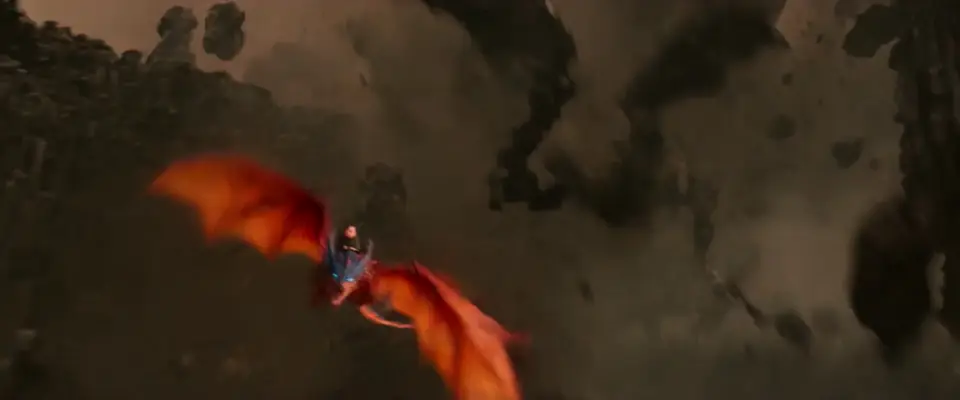
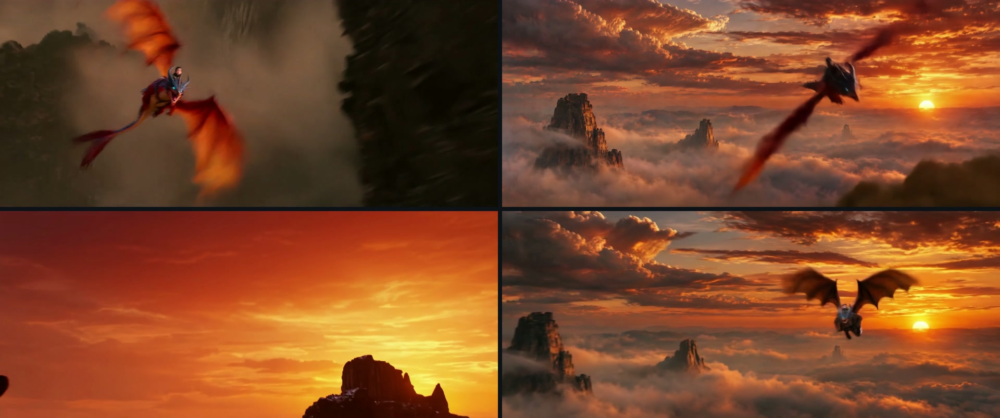

# First real run

[한국어](proof-run.md) | **English**

On 2026-11-18 CineRecast took a recreation all the way through paid generation models for the first time. The reference was a ten-second live-action film clip. Shot for shot, the dragon's rider became a young child, the black dragon became an orange one, and the overcast sky became a sunset. The owner asked for a free cut that may differ from the reference, so the delivered film adds two new shots, sound and end cards, and runs 24.2 seconds.

The first pass, made with the tool as it was then, was not usable. What it showed led to per-shot generation and other features being added to the tool during the run; the second pass used them, and they are in the tool now. Each step below says what it was done with.

  

  

Both images are made from generated frames only; no frame of the reference is in them. Only views in which the rider is small were chosen.

## Contents

- [At a glance](#at-a-glance)
- [Shots](#shots)
- [First pass](#first-pass)
- [What changed for the second pass](#what-changed-for-the-second-pass)
- [Process](#process)
- [Generation settings](#generation-settings)
- [Lessons](#lessons)
- [Cost](#cost)
- [Still open](#still-open)

## At a glance

| Item | Detail |
| --- | --- |
| Reference clip | Live-action film clip: 10.01 s, 240 frames, 23.976 fps, 1920x1080. Picture area 1920x800 (black bars above and below; the picture starts at y = 140) |
| Shots | Five, at frames 0-88, 88-130, 130-187, 187-215 and 215-240 (88, 42, 57, 28 and 25 frames) |
| Swapped | Rider → a young child given by one photograph. Black dragon → the owner's own orange dragon design. Overcast sky → sunset |
| Kept | The crowd on the ground and a giant creature in the background |
| Rights answers, recorded before any work | `reference_rights` yes (the owner answered that they may recreate the clip). `likeness_consent` yes (the guardian's consent recorded). `background_rights` not applicable (the background image was generated in the project) |
| Finished film | 24.2 s, 24 fps, 1920x1080, stereo 48 kHz. Longer than the reference because it is a free cut |
| Generation cost | 62 jobs closed; 447.63 of 639.13 approved credits spent |
| Date | 2026-11-18 |

## Shots

The swap table replaced the rider, the dragon and the sky, and kept the crowd and the giant creature. All five reference shots were generated from that table; in each shot, only the elements that appear in it change.

| Shot | Reference length (frames) | Length in the finished film (frames) | Swapped, notes |
| --- | --- | --- | --- |
| Opening (new) | none | 73 | Not in the reference. Generated from a start frame and an end frame (the first frame of shot 1) |
| 1 | 88 | 89 | Per the swap table. The looping image above is this shot |
| 2 | 42 | 42 | Per the swap table |
| 3 | 57 | 73 | Per the swap table. Runs at natural speed, longer than in the reference |
| 4 | 28 | 28 | Per the swap table |
| Bridge (new) | none | 72 | Not in the reference. Generated from a start frame and an end frame (the first frame of shot 5) |
| 5 | 25 | 72 | Per the swap table. Runs at natural speed, longer than in the reference. A low-resolution validation take, enlarged |
| Two end cards | none | 66 + 66 | Text on black |
| Total | 240 (23.976 fps) | 581 (24 fps) | |

The side-by-side comparison video contains the reference picture, so it is review material only and is not published here.

## First pass

The first pass used the tool exactly as it was before per-shot generation. `plan build` grouped the five shots into two generation units (shots 1-2 and shots 3-5), with method `edit`, one video edit model, and low-resolution drafts.

The result was not usable.

- Inside a unit of several shots, the model changed the order of the shots, left a shot out, and put the cuts 3 to 4 frames off.
- One photograph per element was not enough: the rider and the dragon looked different from shot to shot.

The tool's own report gave these verdicts:

| Shot | Frames | Generation unit | Verdict | Camera score |
| --- | --- | --- | --- | --- |
| 1 | 0-88 | shots 1-2 | pass | - |
| 2 | 88-130 | shots 1-2 | retry | 0.312 |
| 3 | 130-187 | shots 3-5 | pass | - |
| 4 | 187-215 | shots 3-5 | retry | 0.408 |
| 5 | 215-240 | shots 3-5 | retry | 0.186 |

Camera scores are listed only for the shots judged `retry`; the default threshold is 0.6. The verdict looks at camera, motion, colour and flicker. It does not measure whether the right person appears, so every take was also checked by eye.

The tool's own part did run end to end on real generated takes: `conform`, `qc`, `assemble`, `compare`, `report` and `audit` produced a 240-frame, 10.01 s file. What broke was not conforming, scoring, assembly or the ledger. It was putting several shots into one generation call, and giving one photograph per element.

## What changed for the second pass

What the first pass showed led to the features below, built during this run; the second pass used them, and all of them are in the tool now. How the commands behave is covered in the [README](../README.en.md) usage section and the skill documents.

- **One shot per generation unit** (`plan build --per-shot`). A shot shorter than the model's minimum length (3 to 4 s) is padded by holding its last frame, and the padding is cut off again when the take is conformed to the reference.
- **Conforming shot by shot** (`takes cuts`, `conform --take-cuts`). The cuts inside a take and a frozen tail at its end are found, and each shot's stretch of the take is fitted to the frame count of its reference shot.
- **Changing a unit after planning** (`plan unit`). A unit's model, method and input images can be changed without rebuilding the whole plan.
- **Confirming each shot** (`takes review`, `takes confirm`). Before assembly the owner watches every shot next to the reference and confirms one take per shot, and the confirmation is recorded. `assemble` refuses while any shot is unconfirmed.
- **A project budget** (`budget set`). Once a budget for the whole project is in the ledger, batch approvals can only be recorded within it.
- **A sound stage** (the `sound` commands). Music and sound effects are jobs that go through the ledger, like video; they are placed on film frames, mixed into a soundtrack (`sound mix`) and assembled with the film.
- **Extra shots** (the `extra` commands). Shots that are not in the reference (an opening shot and a bridge shot) are generated from a start frame and an end frame. They are cuts to use separately and are never part of `assemble`.

Multi-view reference sheets and the pair sheet are a way of working, not a new feature: they were made with the existing `assets` commands and used as swap images. Instead of a single photograph, one sheet shows the front, the side, the back and a close-up of the face; a pair sheet shows the rider on the dragon, to fix their relative size.

## Process

The label after each step says what it was done with: the tool means cine-recast's commands, with "added during the run" marking steps that used the features built during this run; outside the tool means hand-written ffmpeg scripts.

1. **Analysis** (the tool): found the four cuts that split the clip into five shots and settled the picture area without the black bars (1920x800). Noted what appears in each shot from its first, middle and last stills.
2. **Swap table and rights** (the tool): decided what changes (rider, dragon, sky) and what stays (crowd, giant creature). The three rights questions were asked and answered before any work.
3. **Reference sheets** (the tool's `assets` commands): a single photograph let the rider drift from shot to shot, so the rider and the dragon were each rebuilt as a sheet showing several angles. A pair sheet for the size of rider against dragon and a sheet for the giant creature came later.
4. **Per-shot generation** (the tool, added during the run): one generation per shot. Each reference shot went into a video edit model with the reference images attached, and the model was asked to change only the chosen elements. Shots shorter than the model's minimum length were padded with their last frame before sending.
5. **Review and per-shot confirmation** (the tool, added during the run): every take was checked on a side-by-side video and on stills. The owner made the final choice by watching takes in the generation service and naming the files; those files were matched to takes and recorded as the confirmation for each shot. The choice for shot 1 changed four times, and each time the opening shot was remade to end on the first frame of the new take. Takes are never overwritten, so going back to an earlier choice was always possible.
6. **Shots not in the reference** (the tool, added during the run): the opening shot (the giant creature roaring) and the bridge shot were generated from a start frame and an end frame. Using the first frame of the next shot as the end frame makes the join land exactly on a frame.
7. **Edit** (outside the tool): the frozen tails left by the padding were found by measuring the difference between neighbouring frames and cut out. No shot was trimmed short or sped up; all run at their natural speed. One shot got a light colour grade towards the sunset tone.
8. **Sound** (generation through the tool, added during the run; mix outside the tool): two music cues and thirteen sound effects (roars, explosions, wingbeats, fly-bys, crowd, impacts) were generated. The two cues were spliced at a hit found by measuring their loudness, and the mix was brought to -14 LUFS.
9. **End cards** (outside the tool): two text cards on black, with only wind and a low rumble fading out underneath.

The tool's `assemble` and `sound mix` make the frame-locked version, with the same frame count as the reference. This film is a free cut longer than the reference, so its edit, sound mix and end cards were made outside the tool with hand-written ffmpeg scripts.

## Generation settings

| Purpose | Model | Settings | Credits |
| --- | --- | --- | --- |
| Editing a reference shot (swapping elements) | Kling 3.0 Omni Edit | pro mode, one reference shot plus up to four reference images, 3-4 s | 6 per take (18 in 4K mode) |
| The shot that approaches head-on | Seedance 2.5 (video edit) | 480p validation, sound generation off, 4 s | 15 (81 at 1080p) |
| Opening shot and bridge shot | Kling v3.0 (image to video) | pro mode, start and end frame given, 3 s, sound off | 5.25 per take |
| Reference sheets and key images | GPT Image 2.6 | 2K, highest quality; sheets 3:2, key images 21:9 | 4.5 per image |
| Music | ElevenLabs Music v2.5 | instrumental only, 15-19 s | 2.2-2.8 per cue |
| Sound effects | Mirelo text to audio | 3-10 s, one sentence describing one sound | 0.25 per second |
| Edit, mix, finishing | ffmpeg | ProRes master, H.264 delivery file, -14 LUFS, peak at most -1 dBFS | none |

Credit prices are the ones that applied during this run and may change.

## Lessons

1. **One shot per generation.** Give an edit model several shots at once and it swaps their order or drops one, and the cuts land 3 to 4 frames off. Sending shots one at a time made the problem go away.
2. **Pad short shots, then cut the frozen tail.** Models have a minimum length (3 to 4 s). Holding the last frame to reach it gets the job accepted, but the end of the result may be a frozen picture, or the model may invent motion there. Measuring the difference between neighbouring frames shows exactly where the freeze starts.
3. **A multi-view sheet, not one photograph.** With one photograph, people and creatures change from shot to shot. A single sheet with the front, side, back and a close-up of the face kept them looking the same across shots.
4. **Two elements that touch need a sheet of them together.** For a rider on a dragon, separate sheets do not carry their relative size, and the proportions drift. Prompts did not fix it; adding a sheet of the two together did.
5. **The right proportions are what the owner sees, not what you calculate.** A pair sheet at true scale seemed to make the rider too small in the wide shots, so it was remade, and the owner then chose the true-scale version. Show results before regenerating in a new direction.
6. **A background reference image comes in whole.** Give a sky image as a reference and its rocks and sea of clouds come into the picture too, sometimes pushing out background that should be there. Use a background image only in shots where that background is all there is, and describe light and colour in words for the rest.
7. **Draw it twice on a sheet and you get two.** A sheet of the background creature showed it from the front and from the side, and the result had two creatures. Anything that must appear once gets a single-view reference.
8. **Lift an element you like into a reference.** When one take gets the creature right, make a reference sheet from that frame and pass it on to later takes. That is more reliable than rerolling and hoping it comes back.
9. **For a new shot, end on the next shot's first frame.** A separately generated shot cut in as it is jumps at the join. Giving both a start frame (a key image) and an end frame (the next shot's first frame) makes the two play as one. The model did not accept an end frame alone.
10. **Validate on a cheap tier; use the top tier once the direction is settled.** Right after a reference change, five takes went out together at the delivery tier without the new reference being validated first. They cost 153 credits and the owner rejected all five. The same check at the cheaper tiers would have cost 39.
11. **Music models ignore timing instructions.** Ask for a peak at 16 seconds and the cue may end at 11. Measure the loudness curve of what comes back to find the hit, then cut to it or splice two cues there.
12. **One sentence per sound effect.** Describe one sound precisely, such as "a long, low roar of a giant creature", and add that there must be no music or voice. A roar gains weight when a short, rough one is layered over a long, drawn-out one.
13. **Match the owner's chosen files by content.** Files downloaded from the service carry the job number in their names, so the shot and take are easy to find. Renamed files were matched by a hash of their content.
14. **Every paid call goes through the ledger.** Recording the quote, the approval, the issue and the result in order lets the ledger be checked line by line against the service's usage history. Failed and refused jobs were closed at 0 credits and their refunds were checked.
15. **A shot with nothing to swap comes back almost identical to the reference.** Give an edit model a shot in which no element is swapped and it returns nearly the reference picture. The tool reports the share of nearly identical picture (`overlap_ratio`) for every shot and lists a shot at 0.98 or more as an open item. Before any public release, the owner has to decide whether such a shot must be made again as an original picture.

## Cost

The ledger was checked with the tool's `audit`: all 62 jobs at the generation service were closed, the ledger was consistent, and no problem was found.

| Item | Credits |
| --- | --- |
| Reference images | 54.00 |
| Shot takes | 330.00 |
| Extra shots | 42.00 |
| Sound | 21.63 |
| Total spent | 447.63 |
| Total approved | 639.13 |

Sound and extra-shot jobs entered the ledger during this run; they are the tool's `sound` and `extra` commands now.

- **A 153-credit mistake.** Of the 330.00 credits for shot takes, 153.00 went on a single batch. Right after a reference change, five takes were sent at the delivery tier (four at 18 credits and one at 81) without the new reference being validated first, and the owner rejected all five. At the cheaper tiers the same check would have cost 39 credits (four takes at 6 and one at 15).
- **Refusals.** The service refused a few requests through its content and safety filters. Those jobs were closed at 0 credits and the refunds were checked. No request was disguised and sent again.
- **An error does not mean nothing was accepted.** One submit call ended in a server error, yet three jobs had been accepted and charged. The job list and the transaction history were checked before anything was resubmitted; resubmitting on the error alone would have paid twice for the same work.

## Still open

- **Finishing a confirmed take.** The last shot of the finished film is a low-resolution validation take, enlarged. The tool has no step yet for finishing (enlarging) a confirmed take.
- **Free cut and end cards as tool commands.** A cut longer or shorter than the reference and end cards are not in the tool, so this film's edit, sound mix and end cards are hand-written ffmpeg scripts. The tool's `assemble` and `sound mix` make the frame-locked version.
- **An identity check in the scores.** The similarity scores do not measure whether the right person appears. For now every take has to be checked by eye.
- **Sound judged by measurement only.** Loudness and timing were set from measurements. The sound still needs a human ear.
- **One real run so far.** This is the first and, so far, only run through real generation from start to finish.
- **Tested on Windows only.** No other operating system has been tried.

The introduction to the tool and its commands are in the [README](../README.en.md).
