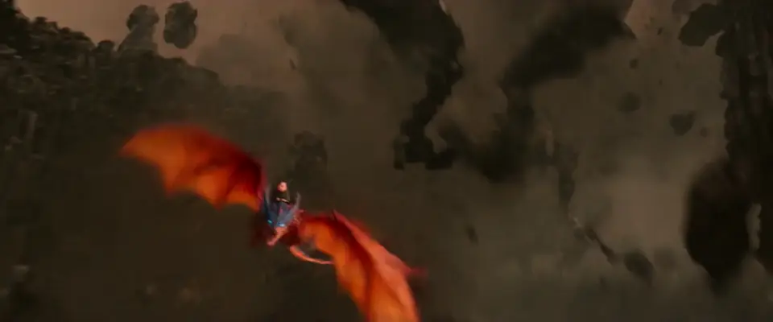
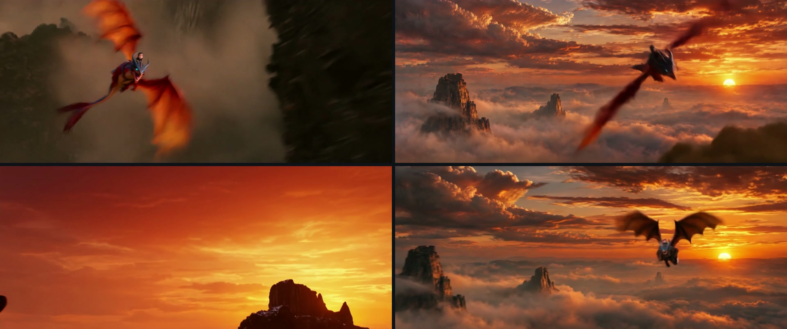

# 첫 실제 생성 기록

**한국어** | [English](proof-run.en.md)

2026-11-18, CineRecast로 유료 생성 모델을 거친 재제작을 처음으로 끝까지 해 보았습니다. 10초짜리 실사 영화 클립을 참조로 삼아, 용을 탄 기수를 어린아이로, 검은 용을 주황색 용으로, 흐린 하늘을 석양으로 바꿔 숏 단위로 다시 만들었습니다. 의뢰인이 원본과 달라도 되는 자유 편집을 원해서, 원본에 없는 숏 두 개와 소리, 엔딩 카드를 더한 24.2초짜리 영상으로 마무리했습니다.

첫 시도는 그때의 도구로 했고 쓸 수 없는 결과를 냈습니다. 그 결과를 보고 숏별 생성을 비롯한 기능을 실행 중에 도구에 더했고, 두 번째 시도는 그 기능으로 했습니다. 그 기능은 지금 도구에 들어 있습니다. 아래에는 단계마다 무엇으로 했는지 적었습니다.

  

  

위 이미지는 생성된 프레임으로만 만들었고, 참조 영상의 프레임은 한 장도 들어 있지 않습니다. 기수가 작게 보이는 장면만 골랐습니다.

## 목차

- [한눈에 보기](#한눈에-보기)
- [숏 구성](#숏-구성)
- [첫 시도](#첫-시도)
- [두 번째 시도를 위해 바꾼 것](#두-번째-시도를-위해-바꾼-것)
- [작업 과정](#작업-과정)
- [생성 설정](#생성-설정)
- [교훈](#교훈)
- [비용](#비용)
- [남은 과제](#남은-과제)

## 한눈에 보기

| 항목 | 내용 |
| --- | --- |
| 참조 클립 | 실사 영화 클립. 10.01초, 240프레임, 23.976 fps, 1920x1080. 실제 화면은 1920x800 (위아래 검은 띠, 위에서 140픽셀부터) |
| 숏 | 5개. 프레임 0-88, 88-130, 130-187, 187-215, 215-240 (88, 42, 57, 28, 25프레임) |
| 바꾼 것 | 기수 → 사진 한 장으로 지정한 어린아이. 검은 용 → 의뢰인이 직접 준 주황색 용 디자인. 흐린 하늘 → 석양 |
| 그대로 둔 것 | 지상의 군중, 배경의 거대 괴수 |
| 권리 기록 (작업 전) | `reference_rights` 예 (의뢰인이 재제작해도 된다고 답함). `likeness_consent` 예 (보호자의 동의를 작업 전에 기록). `background_rights` 해당 없음 (배경 이미지를 프로젝트 안에서 생성) |
| 완성본 | 24.2초, 24 fps, 1920x1080, 스테레오 48 kHz. 자유 편집이라 참조보다 깁니다 |
| 생성 비용 | 끝난 작업 62건, 승인한 639.13크레딧 중 447.63크레딧 사용 |
| 작업일 | 2026-11-18 |

## 숏 구성

교체표는 기수, 용, 하늘을 바꾸고 지상의 군중과 거대 괴수를 그대로 두도록 정했습니다. 참조의 다섯 숏은 모두 이 교체표로 생성했고, 숏마다 화면에 나오는 요소만 바뀝니다.

| 숏 | 참조 길이 (프레임) | 완성본 길이 (프레임) | 바꾼 것과 비고 |
| --- | --- | --- | --- |
| 오프닝 (새 숏) | 없음 | 73 | 원본에 없는 숏. 시작 프레임과 끝 프레임(숏 1의 첫 프레임)을 주고 생성 |
| 1 | 88 | 89 | 교체표대로. 위의 반복 이미지가 이 숏 |
| 2 | 42 | 42 | 교체표대로 |
| 3 | 57 | 73 | 교체표대로. 원래 속도로, 참조보다 길게 씀 |
| 4 | 28 | 28 | 교체표대로 |
| 연결 (새 숏) | 없음 | 72 | 원본에 없는 숏. 시작 프레임과 끝 프레임(숏 5의 첫 프레임)을 주고 생성 |
| 5 | 25 | 72 | 교체표대로. 원래 속도로, 참조보다 길게 씀. 저해상도 검증 테이크를 확대해 넣음 |
| 엔딩 카드 2장 | 없음 | 66 + 66 | 검은 바탕의 글자 카드 |
| 합계 | 240 (23.976 fps) | 581 (24 fps) | |

원본과 결과를 나란히 놓은 비교 영상에는 참조 영상의 화면이 들어 있으므로, 검토용 자료로만 쓰고 여기에는 싣지 않습니다.

## 첫 시도

숏별 생성이 들어가기 전의 도구 그대로 진행했습니다. `plan build`가 다섯 숏을 생성 단위 두 개(숏 1-2, 숏 3-5)로 묶었고, 방법은 `edit`, 영상 편집 모델 하나로 저해상도 초안을 만들었습니다.

결과는 쓸 수 없었습니다.

- 여러 숏이 든 단위 안에서 모델이 숏 순서를 바꾸고, 숏 하나를 빼먹고, 컷을 3에서 4프레임씩 어긋나게 놓았습니다.
- 요소마다 사진 한 장으로는 부족했습니다. 기수와 용이 숏마다 다른 모습으로 나왔습니다.

도구의 보고서가 낸 판정은 이렇습니다.

| 숏 | 프레임 범위 | 생성 단위 | 판정 | 카메라 점수 |
| --- | --- | --- | --- | --- |
| 1 | 0-88 | 숏 1-2 | pass | - |
| 2 | 88-130 | 숏 1-2 | retry | 0.312 |
| 3 | 130-187 | 숏 3-5 | pass | - |
| 4 | 187-215 | 숏 3-5 | retry | 0.408 |
| 5 | 215-240 | 숏 3-5 | retry | 0.186 |

카메라 점수는 다시 하기(`retry`) 판정을 받은 숏만 적었습니다. 기본 기준은 0.6 이상입니다. 판정은 카메라, 움직임, 색, 깜빡임을 볼 뿐 맞는 인물이 나왔는지는 재지 않으므로, 모든 테이크를 눈으로도 확인했습니다.

도구가 맡은 부분은 실제 생성 테이크에서도 끝까지 돌았습니다. `conform`, `qc`, `assemble`, `compare`, `report`, `audit`이 차례로 실행되어 240프레임, 10.01초짜리 파일을 만들었습니다. 무너진 것은 맞춤, 점수, 조립, 장부가 아니라, 여러 숏을 한 번의 생성에 넣는 방식과 사진 한 장짜리 참조였습니다.

## 두 번째 시도를 위해 바꾼 것

첫 시도의 결과를 보고 아래 기능을 이 실행 중에 만들었고, 두 번째 시도는 그 기능으로 했습니다. 모두 지금 도구에 들어 있습니다. 명령의 자세한 동작은 [README](../README.md)의 사용법과 스킬 문서에 있습니다.

- **생성 단위 하나에 숏 하나** (`plan build --per-shot`). 모델의 최소 길이(3에서 4초)보다 짧은 숏은 마지막 프레임을 이어 붙여 길이를 채워 보내고, 받은 테이크를 원본에 맞출 때 채운 부분을 다시 잘라 냅니다.
- **숏별 맞춤** (`takes cuts`, `conform --take-cuts`). 테이크 안의 컷과 끝의 멈춘 화면을 찾고, 숏마다 테이크의 구간을 정해 원본 숏의 프레임 수에 맞춥니다.
- **계획 뒤의 단위 수정** (`plan unit`). 계획을 세운 뒤에도 단위 하나의 모델, 방법, 입력 이미지를 계획 전체를 다시 만들지 않고 바꿀 수 있습니다.
- **숏별 확정** (`takes review`, `takes confirm`). 조립하기 전에 의뢰인이 숏마다 원본과 나란히 놓은 비교 파일을 보고 테이크를 확정하고, 그 확정이 기록됩니다. 확정하지 않은 숏이 있으면 `assemble`이 거부합니다.
- **프로젝트 예산** (`budget set`). 프로젝트 전체의 예산을 장부에 한 번 기록하면, 묶음 승인은 그 안에서만 기록됩니다.
- **사운드 단계** (`sound` 명령들). 음악과 효과음을 영상처럼 장부를 거치는 작업으로 다루고, 영화의 프레임에 놓아 믹스한 사운드트랙(`sound mix`)을 넣어 조립합니다.
- **원본에 없는 숏** (`extra` 명령들). 참조에 없는 숏(오프닝 숏, 연결 숏)을 시작 프레임과 끝 프레임으로 생성합니다. 이 숏은 따로 쓰는 컷이고 `assemble`에는 들어가지 않습니다.

여러 각도의 참조 시트와 짝 시트는 새 기능이 아니라 일하는 방식입니다. 기존 `assets` 명령으로 만들어 교체 자료로 썼습니다. 사진 한 장 대신 정면, 측면, 뒷모습, 얼굴 확대를 한 장에 담은 시트를 쓰고, 기수가 용에 탄 모습을 함께 담은 짝 시트로 둘의 크기 관계를 잡았습니다.

## 작업 과정

괄호 안은 그 단계를 무엇으로 했는지입니다. 도구는 cine-recast의 명령이고, 그중 이 실행 중에 더한 기능을 쓴 단계는 "실행 중에 추가"로 표시했습니다. 도구 밖은 손으로 쓴 ffmpeg 스크립트입니다.

1. **분석** (도구): 컷 네 곳을 찾아 다섯 숏으로 나누고, 검은 띠를 뺀 화면 영역(1920x800)을 확정했습니다. 숏마다 처음, 중간, 끝 스틸을 보고 무엇이 나오는지 적었습니다.
2. **교체표와 권리 확인** (도구): 바꿀 것(기수, 용, 하늘)과 그대로 둘 것(군중, 거대 괴수)을 교체표로 정했습니다. 권리 세 항목은 작업 전에 묻고 답을 기록했습니다.
3. **참조 시트** (도구의 `assets` 명령): 사진 한 장으로는 인물이 숏마다 달라져서, 기수와 용을 각각 여러 각도에서 보여 주는 시트로 다시 만들었습니다. 그 뒤 기수와 용의 크기 관계를 보여 주는 짝 시트와 거대 괴수의 시트를 더했습니다.
4. **숏별 생성** (도구, 실행 중에 추가): 숏 하나를 생성 한 번으로 만들었습니다. 원본 숏을 영상 편집 모델에 넣고 참조 이미지를 붙여, 지정한 요소만 바꾸게 했습니다. 모델의 최소 길이보다 짧은 숏은 마지막 프레임을 이어 붙여 길이를 채워 보냈습니다.
5. **검수와 숏별 확정** (도구, 실행 중에 추가): 받은 테이크는 원본과 나란히 놓은 비교 영상과 스틸로 확인했습니다. 최종 선택은 의뢰인이 생성 서비스 화면에서 직접 보고 파일로 지정했고, 그 파일을 테이크와 대조해 숏별 확정으로 기록했습니다. 숏 1의 선택은 네 번 바뀌었고, 그때마다 오프닝 숏을 새 테이크의 첫 프레임에 맞춰 다시 만들었습니다. 테이크를 덮어쓰지 않고 쌓아 두었기 때문에 언제든 되돌아갈 수 있었습니다.
6. **원본에 없는 숏** (도구, 실행 중에 추가): 오프닝 숏(거대 괴수의 포효)과 연결 숏은 시작 프레임과 끝 프레임을 지정해 생성했습니다. 끝 프레임으로 다음 숏의 첫 프레임을 주면 이음매가 프레임 단위로 맞습니다.
7. **편집** (도구 밖): 길이를 채우느라 생긴 뒤쪽의 멈춘 구간을 앞뒤 프레임의 차이를 재서 찾아 잘라 냈습니다. 숏은 줄이거나 빠르게 돌리지 않고 원래 속도로 이었습니다. 숏 하나는 색을 석양 톤에 맞춰 살짝 보정했습니다.
8. **사운드** (생성 작업은 도구에서 실행 중에 추가, 믹스는 도구 밖): 음악 두 곡과 효과음 13개(포효, 폭발음, 날갯짓, 스쳐 지나가는 소리, 군중, 타격음)를 생성했습니다. 두 곡은 음량을 재서 찾은 타격점에서 이어 붙였고, 전체 음량을 -14 LUFS로 맞췄습니다.
9. **엔딩 카드** (도구 밖): 검은 화면에 글자 카드 두 장을 넣고, 그 아래로 바람 소리와 낮은 울림만 서서히 사라지게 했습니다.

도구의 `assemble`과 `sound mix`는 원본과 프레임 수가 같은 판을 만듭니다. 이 영화는 원본보다 긴 자유 편집이어서 편집, 소리 믹스, 엔딩 카드를 손으로 쓴 ffmpeg 스크립트로 도구 밖에서 만들었습니다.

## 생성 설정

| 용도 | 모델 | 설정 | 크레딧 |
| --- | --- | --- | --- |
| 원본 숏 편집 (요소 교체) | Kling 3.0 Omni Edit | pro 모드, 원본 숏 1개와 참조 이미지 최대 4장, 3-4초 | 테이크당 6 (4K 모드는 18) |
| 정면으로 다가오는 숏 | Seedance 2.5 (video edit) | 480p 검증, 소리 생성 끔, 4초 | 15 (1080p는 81) |
| 오프닝 숏과 연결 숏 | Kling v3.0 (image to video) | pro 모드, 시작 프레임과 끝 프레임 지정, 3초, 소리 끔 | 테이크당 5.25 |
| 참조 시트와 키 이미지 | GPT Image 2.6 | 2K, 최고 품질, 시트는 3:2, 키 이미지는 21:9 | 장당 4.5 |
| 음악 | ElevenLabs Music v2.5 | 기악만, 15-19초 | 곡당 2.2-2.8 |
| 효과음 | Mirelo text to audio | 3-10초, 소리 하나에 한 문장 설명 | 초당 0.25 |
| 편집, 믹스, 마감 | ffmpeg | ProRes 마스터, H.264 배포본, -14 LUFS, 최대 -1 dBFS | 없음 |

크레딧은 이 실행 때의 값이며 바뀔 수 있습니다.

## 교훈

1. **숏 하나에 생성 한 번.** 여러 숏을 한 번에 넣으면 편집 모델이 숏 순서를 바꾸거나 숏을 빼먹고, 컷 위치도 3에서 4프레임씩 어긋납니다. 숏을 하나씩 보내자 이 문제는 사라졌습니다.
2. **짧은 숏은 채워 보내고, 받은 뒤 멈춘 구간을 잘라 낸다.** 모델에는 최소 길이(3에서 4초)가 있습니다. 마지막 프레임을 이어 붙여 길이를 채우면 받아 주지만, 결과의 뒤쪽이 멈춘 화면이 되기도 하고 모델이 움직임을 지어내기도 합니다. 앞뒤 프레임의 차이를 재면 멈춘 구간이 정확히 나옵니다.
3. **참조는 사진 한 장이 아니라 여러 각도의 시트로.** 사진 한 장만 주면 인물과 크리처가 숏마다 달라집니다. 정면, 측면, 뒷모습과 얼굴 확대를 한 장에 담은 시트를 주자 숏이 바뀌어도 같은 모습을 유지했습니다.
4. **맞닿은 두 요소에는 둘이 함께 있는 짝 시트.** 기수와 용처럼 붙어 있는 두 요소는 각각의 시트만으로는 크기 관계가 전달되지 않아 비율이 틀어집니다. 프롬프트로는 고쳐지지 않았고, 둘이 함께 있는 시트를 더하자 해결됐습니다.
5. **비율의 정답은 계산이 아니라 의뢰인의 눈.** 짝 시트를 실제 크기 비율로 만들었더니 넓은 숏에서 기수가 너무 작아 보인다고 보고 다시 만들었는데, 의뢰인은 오히려 처음 버전을 골랐습니다. 방향을 바꾸는 재생성 전에 결과를 먼저 보여 주는 것이 맞습니다.
6. **배경 참조 이미지는 통째로 붙는다.** 하늘 이미지를 참조로 주면 그 이미지 속 바위와 구름 바다까지 화면에 들어오고, 있어야 할 배경이 사라지기도 합니다. 배경 이미지는 그 배경만 나오는 숏에 쓰고, 나머지 숏은 빛과 색을 글로 설명하는 편이 안전합니다.
7. **시트에 두 번 그리면 두 마리가 나온다.** 배경 크리처의 시트에 정면과 측면 두 장면을 넣었더니 결과에 괴수가 두 마리 나왔습니다. 화면에 하나만 있어야 하는 것은 한 장면짜리 참조로 줍니다.
8. **마음에 든 요소는 프레임을 뽑아 참조로 올린다.** 어떤 테이크의 괴수가 마음에 들면 그 프레임으로 참조 시트를 만들어 이후 테이크에 물려줍니다. 다시 뽑으면서 같은 것이 나오기를 기다리는 것보다 확실합니다.
9. **원본에 없는 숏은 끝 프레임을 다음 숏의 첫 프레임으로.** 따로 만든 숏을 그냥 붙이면 이음매가 튑니다. 시작 프레임(키 이미지)과 끝 프레임(다음 숏의 첫 프레임)을 함께 지정하면 한 숏처럼 이어집니다. 끝 프레임만 주는 요청은 모델이 받지 않았습니다.
10. **검증은 싼 등급으로, 최고 등급은 방향이 정해진 뒤에.** 참조를 바꾼 직후 그 참조를 먼저 검증하지 않고 납품 등급으로 테이크 다섯 개를 한 번에 보내 153크레딧을 썼고, 의뢰인은 다섯 개를 모두 탈락시켰습니다. 같은 확인을 더 싼 등급으로 했다면 39크레딧이었습니다.
11. **음악 모델은 시간 지시를 지키지 않는다.** "16초에 절정"이라고 써도 11초에 끝내 버립니다. 받은 곡의 음량 곡선을 재서 타격점을 찾고, 그 지점에 컷을 맞추거나 두 곡을 이어 붙이는 편이 확실합니다.
12. **효과음은 소리 하나에 한 문장.** "거대한 괴수의 길고 낮은 포효"처럼 소리 하나를 구체적으로 적고, 음악과 목소리가 없어야 한다고 덧붙입니다. 포효는 짧고 거친 소리와 길게 끄는 소리를 겹치면 힘이 생깁니다.
13. **의뢰인이 고른 파일은 내용으로 대조한다.** 서비스에서 내려받은 파일의 이름에는 작업 번호가 들어 있어 어느 숏의 어느 테이크인지 바로 찾을 수 있습니다. 이름이 바뀐 파일은 내용의 해시로 대조했습니다.
14. **유료 호출은 전부 장부를 거친다.** 견적 기록, 승인, 발급, 결과 등록을 차례로 남기면 서비스의 사용 내역과 한 줄씩 맞춰 볼 수 있습니다. 실패하거나 거부된 작업은 0크레딧으로 닫고 환불을 확인했습니다.
15. **바꿀 것이 없는 숏은 원본과 거의 같은 그림이 된다.** 교체할 요소가 없는 숏을 편집 모델에 넣으면 참조와 거의 같은 화면이 돌아옵니다. 도구는 숏마다 원본과 거의 같은 영역의 비율(`overlap_ratio`)을 보고서에 싣고 0.98 이상이면 열린 항목에 올립니다. 공개하기 전에 그런 숏을 독자적인 그림으로 다시 만들어야 하는지는 의뢰인이 판단해야 합니다.

## 비용

도구의 `audit`으로 장부를 점검했습니다. 생성 서비스의 작업 62건이 모두 닫혔고, 장부는 앞뒤가 맞았으며 문제는 나오지 않았습니다.

| 항목 | 크레딧 |
| --- | --- |
| 참조 이미지 | 54.00 |
| 숏 테이크 | 330.00 |
| 추가 숏 | 42.00 |
| 사운드 | 21.63 |
| 사용 합계 | 447.63 |
| 승인 한도 합계 | 639.13 |

사운드와 원본에 없는 숏의 작업은 이 실행 중에 장부에 들어왔고, 지금은 도구의 `sound`, `extra` 명령입니다.

- **153크레딧짜리 실수.** 숏 테이크 330.00 중 153.00은 한 번의 묶음입니다. 참조를 바꾼 직후, 바뀐 참조를 먼저 검증하지 않고 납품 등급으로 테이크 다섯 개(18크레딧짜리 넷과 81크레딧짜리 하나)를 보냈고, 의뢰인은 다섯 개를 모두 탈락시켰습니다. 같은 확인을 더 싼 등급으로 했다면 39크레딧(6크레딧짜리 넷과 15크레딧짜리 하나)이면 됐습니다.
- **서비스의 거부.** 생성 서비스가 콘텐츠·안전 필터로 몇몇 요청을 거부했습니다. 거부된 작업은 0크레딧으로 닫고 환불을 확인했습니다. 입력을 꾸며 다시 보내는 일은 하지 않았습니다.
- **오류가 나도 접수됐을 수 있다.** 제출 호출 한 번이 서버 오류로 끝났지만, 실제로는 작업 세 건이 접수되어 크레딧이 차감되어 있었습니다. 다시 제출하기 전에 작업 목록과 거래 내역부터 확인했습니다. 오류만 보고 바로 다시 보내면 같은 작업에 두 번 돈을 낼 수 있습니다.

## 남은 과제

- **확정 테이크의 마감 단계.** 완성본의 마지막 숏은 저해상도 검증 테이크를 확대한 것입니다. 확정된 테이크를 키워 마감하는 단계가 도구에 아직 없습니다.
- **자유 편집과 엔딩 카드를 도구 명령으로.** 원본보다 길거나 짧은 자유 편집과 엔딩 카드는 도구에 없어서, 이 영화의 편집, 소리 믹스, 엔딩 카드는 손으로 쓴 ffmpeg 스크립트로 만들었습니다. 도구의 `assemble`과 `sound mix`는 원본과 프레임 수가 같은 판을 만듭니다.
- **점수에 인물 확인.** 일치도 점수는 맞는 인물이 나왔는지를 재지 않습니다. 지금은 모든 테이크를 눈으로 확인해야 합니다.
- **소리는 측정으로만 판단.** 음량과 타이밍은 측정값으로 맞췄습니다. 사람이 직접 들어 보고 판단하는 일이 남았습니다.
- **실제 생성은 한 번뿐.** 실제 생성으로 처음부터 끝까지 해 본 것은 이 실행이 처음이자 지금까지 유일합니다.
- **Windows에서만 시험.** 다른 운영 체제에서는 시험하지 않았습니다.

도구의 소개와 명령은 [README](../README.md)에 있습니다.
